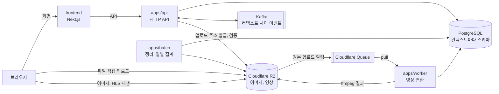

# Contentria

마크다운으로 글을 쓰고, 이미지와 영상을 붙여 발행하는 블로그 플랫폼이다.
독자는 블로그를 구독하고 좋아요와 댓글을 남기며, 블로그 주인은 대시보드에서 방문 추이와 인기 글을 본다.

## 주요 기능

| 기능 | 내용 |
|---|---|
| 블로그와 글 | 블로그를 만들고 카테고리로 글을 나눈다. 마크다운 편집기로 쓰고, 임시저장, 발행, 비공개를 오간다. 공개 주소는 `/@블로그주소/글주소`다 |
| 이미지 | 브라우저가 저장소에 바로 올린다. 서버는 파일의 실제 형식을 확인하고 사진의 위치 정보 같은 메타데이터를 지운다 |
| 영상 | 글마다 영상 하나를 붙인다. 올린 원본을 720p와 480p HLS로 변환하고 포스터를 만든다. 독자는 화질이 자동으로 바뀌는 스트리밍으로 본다 |
| 구독, 좋아요, 댓글 | 블로그를 구독하고, 글에 좋아요와 댓글을 남긴다 |
| 알림 | 구독한 블로그의 새 글, 내 글의 새 댓글을 사이트 알림함으로 받는다 |
| 대시보드 | 오늘과 어제의 방문자와 조회수, 2주에서 90일의 추이, 인기 글. 방문자는 해시한 키로만 센다 |
| 로그인 | 이메일 인증 코드, 비밀번호, Google 계정 |
| 계정 설정 | Google 연동과 해제, 비밀번호 바꾸기와 재설정, 이메일 주소 바꾸기, 탈퇴 |

## 시스템 구성

| 구성 요소 | 하는 일 |
|---|---|
| frontend | 공개 블로그와 글은 서버에서 렌더링해 검색에 노출하고, 대시보드와 편집기는 브라우저에서 동작한다 |
| apps/api | 모든 HTTP 요청을 받는다. 컨텍스트 사이의 이벤트를 Kafka로 보내고 받는다 |
| apps/worker | 저장소가 큐에 남긴 업로드 알림을 가져와 ffmpeg로 영상을 변환한다 |
| apps/batch | 쓰이지 않는 이미지와 영상을 지우고, 방문 기록을 하루 단위로 집계한다 |
| apps/migrator | 배포 때 컨텍스트마다 데이터베이스 마이그레이션을 실행한다 |

## 설계에서 신경 쓴 것

| 주제 | 내용 |
|---|---|
| 컨텍스트 기준 모듈러 모놀리스 | 회원, 출판, 상호작용, 알림, 미디어, 분석의 여섯 경계로 코드를 나눴다. 각 컨텍스트는 공개 계약(`-api`)과 구현(`-core`) 모듈로 되어 있고, 다른 컨텍스트에는 계약으로만 의존한다. 나중에 컨텍스트 하나를 떼어 서비스로 만들 수 있다 |
| 규칙을 테스트로 강제 | 모듈 사이의 의존 방향, 헥사고날과 레이어드의 계층 규칙을 ArchUnit 테스트가 확인한다. 규칙을 어기면 빌드가 실패한다 |
| 이벤트로 잇는 컨텍스트 | 글 발행, 글 삭제, 댓글은 이벤트로 알린다. 보내는 쪽은 같은 트랜잭션에서 아웃박스에 쓰고, 릴레이가 Kafka로 보내고, 받는 쪽은 인박스로 중복을 거른다 |
| 데이터 경계 | 컨텍스트마다 스키마와 마이그레이션 롤을 따로 둔다. 실행 중인 프로세스의 롤은 데이터만 읽고 쓰며, 컨텍스트를 넘는 외래키는 없다 |
| 영상 파이프라인 | 큰 파일은 서버를 거치지 않고 저장소로 바로 간다. 변환은 큐에서 가져가는 별도 프로세스가 맡고, 실패하면 큐가 다시 보내며, 세 번 실패하면 따로 모은다. 같은 알림이 두 번 와도 결과가 같다 |
| 실제 의존으로 테스트 | 통합 테스트는 Testcontainers로 PostgreSQL, Kafka, S3 호환 저장소, ffmpeg를 띄워 돌린다. 영상 변환 테스트는 실제로 만든 HLS 파일이 모두 저장소에 있는지까지 확인한다 |

설계 문서는 [backend/docs](backend/docs/README.md)에 있다. 경계를 나눈 이유부터 컨텍스트별 규칙까지 읽는 순서대로 정리했다.

## 기술 스택

| 영역 | 기술 |
|---|---|
| 프론트엔드 | Next.js 16, React 19, TypeScript, Tailwind CSS, TanStack Query, Zustand, MDXEditor, hls.js |
| 백엔드 | Kotlin, Spring Boot 4, Spring Security, Spring Data JPA, Spring Batch, Spring Kafka, Flyway, JDK 25 |
| 데이터와 메시징 | PostgreSQL, Kafka |
| 파일과 영상 | Cloudflare R2 (S3 API), Cloudflare Queues, ffmpeg |
| 테스트 | JUnit 5, AssertJ, Testcontainers, ArchUnit |
| 인프라 | Kubernetes, ArgoCD, Envoy Gateway, cert-manager, CloudNativePG |

## 저장소 구성

| 폴더 | 내용 | 안내 |
|---|---|---|
| `frontend/` | 웹 화면 | [frontend/README.md](frontend/README.md) |
| `backend/` | API, worker, 배치, 마이그레이터와 설계 문서 | [backend/README.md](backend/README.md) |
| `infra/gitops/` | ArgoCD가 맞추는 배포 매니페스트 | [infra/gitops/README.md](infra/gitops/README.md) |
| `infra/database/` | 새 데이터베이스의 롤, 스키마, 권한 SQL | [backend/README.md의 데이터베이스](backend/README.md#데이터베이스) |

## 현재 상태

처음 만든 백엔드를 컨텍스트 기준 구조로 다시 만들었다. 이전 구현은 `legacy-final` 태그에 남겼고, 지금 운영 중인 것은 이전 구현이다.

| 항목 | 상태 |
|---|---|
| 백엔드 (6개 컨텍스트, 4개 프로세스) | 새 구조로 옮겼다 |
| 프론트엔드 | 이전 백엔드의 API에 맞춰져 있다. 새 API로 옮기는 작업이 남았다 |
| 배포 | 이전 구현의 이미지를 배포하고 있다. 새 프로세스의 이미지와 매니페스트는 아직 없다 |
