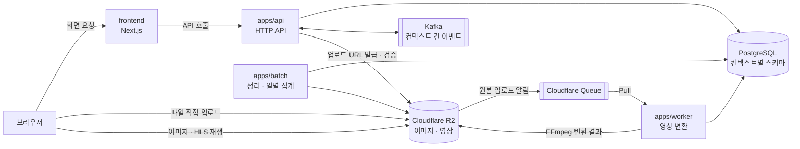

# Contentria

사용자가 자신만의 블로그를 개설하고 마크다운으로 글을 작성·발행할 수 있는 블로그 플랫폼입니다.

## 주요 기능

- **블로그 및 게시글 관리**: 개인 블로그(`/@<블로그명>`)를 개설하고 카테고리별로 글을 분류합니다. 마크다운 에디터를 통해 글을 작성하고 발행할 수 있습니다.
- **이미지 업로드**: 클라이언트에서 스토리지(Cloudflare R2)로 직접 업로드합니다. 서버는 실제 파일 형식을 검증하고 위치 정보(EXIF) 등 민감한 메타데이터를 제거합니다.
- **영상 스트리밍**: 게시글마다 영상 하나를 첨부할 수 있습니다. 업로드된 원본 영상을 720p·480p HLS 포맷으로 변환하고 썸네일(포스터)을 추출하여, 네트워크 환경에 맞춰 화질이 자동 조절되는 적응형 스트리밍(ABR)을 제공합니다.
- **구독·좋아요·댓글**: 관심 있는 블로그를 구독하고, 게시글에 좋아요와 댓글을 남길 수 있습니다.
- **알림**: 구독 중인 블로그의 새 글이나 내 글에 달린 새 댓글을 사이트 내 알림함으로 받아볼 수 있습니다.
- **통계 대시보드**: 오늘·어제의 방문자 수와 조회수, 최근 14일~90일간의 추이, 인기 게시글 통계를 제공합니다. 방문자는 개인정보를 저장하지 않고 해시 처리된 식별자로만 집계합니다.
- **인증 및 계정 설정**: 이메일 인증 코드, 비밀번호, Google 계정을 통한 로그인을 지원합니다. Google 계정 연동·해제, 비밀번호 변경 및 재설정, 이메일 변경, 회원 탈퇴 기능을 제공합니다.

## 시스템 구성

| 구성 요소       | 역할                                                                                                                       |
| --------------- | -------------------------------------------------------------------------------------------------------------------------- |
| `frontend`      | 공개 블로그와 게시글은 검색 엔진 노출(SEO)을 위해 서버에서 렌더링(SSR)하고, 대시보드와 에디터는 클라이언트에서 동작합니다. |
| `apps/api`      | 클라이언트 HTTP 요청을 처리하며, Kafka를 통해 컨텍스트 간 이벤트를 발행하고 구독합니다.                                    |
| `apps/worker`   | Cloudflare Queues에서 R2 업로드 이벤트 알림을 가져와(Pull) FFmpeg로 영상을 변환합니다.                                     |
| `apps/batch`    | 미사용 이미지·영상을 정리하고, 일 단위 방문 통계를 집계합니다.                                                             |
| `apps/migrator` | 배포 시 컨텍스트별 데이터베이스 스키마 마이그레이션을 수행합니다.                                                          |

## 설계 주안점

- **바운디드 컨텍스트 기반 모듈러 모놀리스**
  - 회원, 출판, 상호작용, 알림, 미디어, 분석의 6개 컨텍스트로 모듈을 분리했습니다.
  - 각 컨텍스트는 외부에 노출하는 인터페이스 모듈(`-api`)과 내부 구현 모듈(`-core`)로 나뉘며, 다른 컨텍스트를 참조할 때는 `-core`가 아닌 `-api` 모듈만 의존할 수 있습니다.
  - 추후 필요에 따라 특정 컨텍스트를 독립 서비스로 분리할 수 있는 구조입니다.
- **테스트를 통한 아키텍처 규칙 강제**
  - 모듈 간 의존 방향과 헥사고날·레이어드 아키텍처의 계층 규칙을 ArchUnit 테스트로 검증합니다.
  - 규칙을 위반하면 빌드가 실패합니다.
- **이벤트 기반 컨텍스트 간 통신**
  - 게시글 발행·삭제, 댓글 작성 등 컨텍스트 간 상태 전파는 비동기 이벤트로 처리합니다.
  - 발행 측에서는 비즈니스 로직과 동일한 트랜잭션 내에서 Outbox 테이블에 이벤트를 기록한 뒤 릴레이를 통해 Kafka로 전송하고, 수신 측에서는 Inbox 테이블로 중복 처리를 방지합니다.
- **데이터베이스 격리**
  - 컨텍스트마다 독립된 PostgreSQL 스키마를 두고, 스키마 변경(DDL) 권한을 가진 마이그레이션 전용 DB 계정을 컨텍스트별로 분리해 운영합니다.
  - 실행 중인 애플리케이션(`api`, `batch`, `worker`)이 사용하는 DB 계정에는 데이터 조회·수정(DML) 권한만 부여하며, 컨텍스트 간 물리적 외래키(FK)는 두지 않습니다.
- **비동기 영상 변환 파이프라인**
  - 대용량 원본 파일은 API 서버를 거치지 않고 스토리지(Cloudflare R2)로 직접 업로드됩니다.
  - 업로드 완료 시 R2 이벤트 알림이 Cloudflare Queues로 전달되며, 별도 워커 프로세스가 큐에서 메시지를 가져와(Pull) 변환합니다. 실패 시 최대 3회 재시도 후 실패 큐(DLQ)로 격리합니다.
  - 동일한 업로드 알림이 중복 수신되더라도 멱등하게 처리됩니다.
- **실제 인프라 환경 기반의 통합 테스트**
  - Testcontainers를 활용해 PostgreSQL, Kafka, S3 호환 스토리지, FFmpeg 컨테이너를 실제로 띄워 통합 테스트를 수행합니다.
  - 영상 변환 테스트의 경우 인코딩된 HLS 세그먼트와 플레이리스트 파일이 스토리지에 정상 생성되었는지까지 검증합니다.

상세한 아키텍처와 컨텍스트별 도메인 규칙은 [backend/docs](backend/docs/README.md)에 읽기 순서대로 정리되어 있습니다.

## 기술 스택

| 영역               | 기술                                                                                                |
| ------------------ | --------------------------------------------------------------------------------------------------- |
| 프론트엔드         | Next.js 16, React 19, TypeScript, Tailwind CSS, TanStack Query, Zustand, MDXEditor, hls.js          |
| 백엔드             | Kotlin, Spring Boot 4, Spring Security, Spring Data JPA, Spring Batch, Spring Kafka, Flyway, JDK 25 |
| 데이터 및 메시징   | PostgreSQL, Kafka                                                                                   |
| 미디어 및 스토리지 | Cloudflare R2 (S3 API), Cloudflare Queues, FFmpeg                                                   |
| 테스트             | JUnit 5, AssertJ, Testcontainers, ArchUnit                                                          |
| 인프라             | Kubernetes, ArgoCD, Envoy Gateway, cert-manager, CloudNativePG                                      |

## 저장소 구조

| 경로              | 설명                                                   | 상세 문서                                                        |
| ----------------- | ------------------------------------------------------ | ---------------------------------------------------------------- |
| `frontend/`       | Next.js 웹 프론트엔드                                  | [frontend/README.md](frontend/README.md)                         |
| `backend/`        | API, Worker, Batch, Migrator 애플리케이션 및 설계 문서 | [backend/README.md](backend/README.md)                           |
| `infra/gitops/`   | ArgoCD 기반 Kubernetes 배포 매니페스트                 | [infra/gitops/README.md](infra/gitops/README.md)                 |
| `infra/database/` | 데이터베이스 초기 Role, 스키마, 권한 설정 SQL          | [backend/README.md#데이터베이스](backend/README.md#데이터베이스) |
