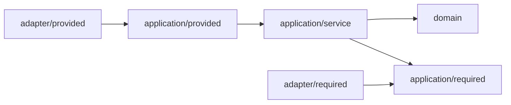
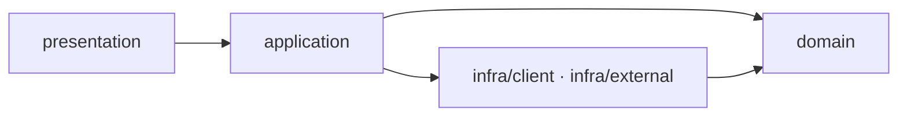

# 컨텍스트 내부 아키텍처 (Internal Architecture)

각 `<컨텍스트>-core` 모듈의 내부 아키텍처는 컨텍스트의 도메인 복잡도와 특성에 맞춰 선택합니다. 반면 외부에 노출하는 계약(`<컨텍스트>-api` 등)은 모든 컨텍스트가 동일한 형태를 따릅니다.
전체 모듈 배치는 [01-module-structure.md](01-module-structure.md)에서, 컨텍스트 간 통신 규칙은 [03-context-integration.md](03-context-integration.md)에서 다룹니다.

## 모든 컨텍스트에 공통으로 고정하는 규칙과 개별 선택 항목

| 모든 컨텍스트에 공통 적용 (외부 계약 및 원칙)                    | 컨텍스트별로 선택 (내부 구현 방식)                  |
| ---------------------------------------------------------------- | --------------------------------------------------- |
| `<컨텍스트>-api` 모듈의 구조 (공개 포트 인터페이스, DTO, 이벤트) | `-core` 내부 아키텍처 패턴 (헥사고날 vs 레이어드)   |
| 컨텍스트 전용 DB 스키마 사용 및 독립적인 Flyway 마이그레이션     | 도메인 모델의 풍부함과 추상화 수준                  |
| Transactional Outbox를 통한 이벤트 발행 및 Inbox 중복 수신 방지  | 리포지토리 외 외부 의존성에 대한 포트 추상화 여부   |
| 리포지토리 작성 규칙 (아래 `리포지토리` 절 참고)                 |                                                     |
| 타 컨텍스트 호출을 번역 계층(ACL) 한 곳으로 격리                 |                                                     |
| 채널별 Spring `@Configuration` 클래스 제공 (`config` 패키지)     |                                                     |

외부 계약이 모든 컨텍스트에서 동일하게 고정되어 있으므로, 처음에 단순한 레이어드 아키텍처로 시작한 컨텍스트라도 추후 도메인 규칙이 복잡해지면 다른 컨텍스트에 전혀 영향을 주지 않고 내부만 헥사고날 아키텍처로 전환할 수 있습니다.

## 내부 아키텍처 선정 기준

| 판단 질문                                                              | 권장 아키텍처 |
| ---------------------------------------------------------------------- | ------------- |
| 제품의 차별점이 되는 핵심(Core) 서브도메인인가?                        | 헥사고날      |
| 단일 애그리거트 내부에서 검증해야 하는 비즈니스 불변식과 규칙이 많은가?| 헥사고날      |
| 외부 인프라나 서드파티 연동이 많고 향후 교체·모킹 필요성이 높은가?     | 헥사고날      |
| 위 세 가지에 모두 해당하지 않는가?                                     | 레이어드      |

## 컨텍스트별 아키텍처 배정

| 컨텍스트       | 서브도메인 분류   | 내부 아키텍처 | 선정 근거                                                                                                         |
| -------------- | ----------------- | ------------- | ----------------------------------------------------------------------------------------------------------------- |
| `member`       | 일반 (Generic)    | 헥사고날      | 인증·토큰·비밀번호 등 보안 규칙이 복잡하며, Google OAuth·SMTP·reCAPTCHA 등 외부 연동 지점이 많습니다.             |
| `publishing`   | 핵심 (Core)       | 헥사고날      | 제품의 핵심 도메인으로 발행 상태, 슬러그 유일성, 카테고리 트리, 소유권 검증 등 비즈니스 규칙이 가장 풍부합니다.   |
| `media`        | 지원 (Supporting) | 헥사고날      | 도메인 모델 자체는 영상 상태 머신 중심으로 간결하지만, Cloudflare R2·Queues·FFmpeg 등 무거운 외부 의존이 많습니다.|
| `interaction`  | 지원 (Supporting) | 레이어드      | 구독·좋아요 중복 방지와 댓글 작성 등 규칙이 단순하며, 외부 연동도 타 컨텍스트 두 곳(`member`, `publishing`)뿐입니다.|
| `analytics`    | 지원 (Supporting) | 레이어드      | 쓰기 작업은 방문 로그 적재뿐이고 대부분 집계 쿼리 위주여서 도메인 모델이 얇습니다.                                |
| `notification` | 일반 (Generic)    | 레이어드      | 도메인 이벤트를 수신해 알림 내역을 저장하고 조회하는 직관적인 CRUD 흐름입니다.                                    |

> 컨텍스트의 내부 아키텍처 배정을 변경할 때는 위 표와 해당 컨텍스트의 `docs/contexts/<컨텍스트>/README.md`를 함께 수정합니다.

## 헥사고날과 레이어드의 구조적 차이

| 비교 항목                                      | 레이어드 (Layered)                             | 헥사고날 (Hexagonal)                                              |
| ---------------------------------------------- | ---------------------------------------------- | ----------------------------------------------------------------- |
| 리포지토리 인터페이스 위치                     | `domain/`                                      | `application/required/`                                           |
| 리포지토리 구현 방식                           | Spring Data 자동 생성 (복잡한 쿼리는 `@NamedQuery`) | Spring Data 자동 생성 (복잡한 쿼리는 `@NamedQuery`)               |
| 리포지토리 외 외부 의존 (타 컨텍스트, 외부 API)| `application`이 `infra/` 클래스를 직접 호출    | `application/required/`의 포트를 정의하고 `adapter/required/`가 구현 |
| 인바운드 진입점이 호출하는 대상                | `application` 계층의 서비스 클래스             | `application/provided/`의 유스케이스 인터페이스                   |

두 아키텍처 모두 데이터 저장소(리포지토리)에 대해서는 인터페이스를 통한 의존성 역전(DIP)을 적용합니다. 핵심 차이는 **리포지토리 외의 외부 의존성과 인바운드 유스케이스까지 포트 인터페이스로 추상화하는지 여부**입니다.

## 리포지토리

리포지토리 설계 규칙은 헥사고날과 레이어드 모두 동일하게 적용합니다.

리포지토리 인터페이스는 Spring Data의 마커 인터페이스인 `Repository<T, ID>`를 상속하며, 실제 사용하는 메서드만 명시적으로 선언합니다. 런타임 구현체는 Spring Data가 생성하며, 메서드 이름만으로 표현하기 어려운 쿼리는 엔티티 클래스에 `@NamedQuery`로 정의하고 리포지토리에 동일한 이름의 메서드를 선언해 연결합니다.

```kotlin
// 엔티티: 매핑 정보가 있는 곳에 쿼리를 함께 응집시킵니다. 위치 기반 파라미터(?1)를 사용하면 리포지토리에 @Param이 필요 없습니다.
@Entity
@NamedQuery(
    name = "Comment.findThread",
    query = "select c from Comment c where c.postId = ?1 order by c.createdAt",
)
class Comment

// 리포지토리: 실제로 필요한 메서드만 선언합니다. findThread는 엔티티의 Comment.findThread 쿼리를 실행합니다.
interface CommentRepository : Repository<Comment, UUID> {
    fun save(comment: Comment): Comment
    fun findById(id: UUID): Comment?
    fun existsByPostIdAndAuthorId(postId: UUID, authorId: UUID): Boolean
    fun findThread(postId: UUID): List<Comment>
}
```

| 리포지토리 작성 규칙                                                                            | 이유                                                                                                       |
| ----------------------------------------------------------------------------------------------- | ---------------------------------------------------------------------------------------------------------- |
| `JpaRepository`나 `CrudRepository` 대신 마커 인터페이스인 `Repository`를 상속한다               | 도메인에서 허용하지 않는 메서드(`deleteAll`, `findAll` 등)가 무분별하게 노출되는 것을 방지합니다.          |
| 리포지토리 인터페이스에 `@Query`, `@Lock`, `@EntityGraph`, `@Param`을 붙이지 않고 엔티티의 `@NamedQuery`로 둔다 | JPQL 쿼리 문장과 락 전략은 영속성 매핑 세부사항이므로, 이미 JPA 매핑이 존재하는 엔티티 클래스에 함께 둡니다.|
| 메서드 시그니처에 `Page`, `Pageable`, `Sort`, `Specification` 등 Spring Data 전용 타입을 쓰지 않는다 | 애플리케이션·도메인 계층이 Spring Data 기술 API에 결합되지 않도록 의존성을 마커 인터페이스 하나로 제한합니다.|
| 메서드 이름이 유비쿼터스 언어와 어긋나면 쿼리 메서드 파싱에 맞추지 않고 `@NamedQuery`로 작성한다 | 프레임워크의 메서드 명명 규칙 때문에 도메인 언어가 왜곡되는 것을 방지합니다.                               |
| 애그리거트 루트당 하나의 리포지토리만 둔다                                                      | 영속성 저장과 조회의 단위를 애그리거트 경계와 일치시킵니다.                                                |

### Spring Data 커스텀 Fragment(`<인터페이스>Impl`)를 사용하지 않는 이유

쿼리 구현체를 영속성 어댑터 패키지(`adapter/required/persistence` 또는 `infra/persistence`)로 분리하기 위해 Spring Data Fragment 방식을 검토했으나 채택하지 않았습니다.
Spring Data(4.1 기준 `DefaultRepositoryConfiguration.getImplementationBasePackages()`)는 Fragment 구현 클래스를 **리포지토리 인터페이스가 위치한 패키지 및 그 하위 패키지에서만** 탐색합니다. 리포지토리 인터페이스가 `application/required`나 `domain`에 위치하므로 Fragment 구현체 역시 해당 패키지 하위에 두어야 하는데, 이는 영속성 구현 코드를 내부 계층에 두는 결과를 낳기 때문입니다.

추후 단일 JPQL로 작성하기 어려운 복잡한 동적 쿼리가 필요해지면 그 시점에 별도 구현 방식을 정의합니다.

### 이 규칙의 전제 조건과 예외

| 상황                                                                                      | 대안                                                                                   |
| ----------------------------------------------------------------------------------------- | -------------------------------------------------------------------------------------- |
| 도메인 모델과 JPA 엔티티를 물리적으로 분리하는 경우 (순수 도메인 객체를 영속화할 때)      | 리포지토리를 프레임워크 무관 순수 인터페이스로 두고, 영속성 어댑터에서 매핑과 함께 직접 구현합니다. |

위 `Repository` 마커 방식은 **도메인 엔티티가 곧 JPA `@Entity`인 경우**에 성립하는 실용적 규칙입니다.

### 리포지토리 테스트 전략

- `Repository` 마커 인터페이스에는 기본 상속 메서드가 없으므로, 단위 테스트에서는 인메모리 Fake 구현체를 손쉽게 작성해 주입할 수 있습니다.
- `@NamedQuery` 문법과 실제 쿼리 동작은 Testcontainers 기반의 PostgreSQL 통합 테스트로 검증합니다. `@NamedQuery`에 문법 오류가 있으면 스프링 컨텍스트 기동 시점에 즉시 실패하므로 통합 테스트에서 바로 감지됩니다.

## 헥사고날 아키텍처 상세 규칙

### 패키지 구조

```text
com.contentria.<컨텍스트>/
├── domain/                      애그리거트, 엔티티, 값 객체(VO), 도메인 규칙
├── application/
│   ├── provided/                인바운드 진입점이 호출하는 유스케이스 인터페이스 (Command / Query)
│   ├── required/                애플리케이션이 필요로 하는 아웃바운드 포트 인터페이스
│   │                            (리포지토리, 외부 시스템 연동, 타 컨텍스트 조회 포트)
│   └── service/                 유스케이스 구현체 및 <컨텍스트>-api 공개 포트 구현체
├── adapter/
│   ├── provided/                인바운드 어댑터 (진입점)
│   │   ├── web/                 HTTP 컨트롤러
│   │   ├── messaging/           Kafka 이벤트 컨슈머
│   │   ├── batch/               Spring Batch 잡
│   │   └── queue/               외부 큐 폴러 (media 컨텍스트 전용)
│   └── required/                아웃바운드 어댑터 (application/required 포트의 구현체)
│       ├── messaging/           Outbox 이벤트 기록 어댑터
│       ├── <상대 컨텍스트>/       타 컨텍스트의 -api를 호출하는 번역 계층 (ACL)
│       └── <외부 시스템>/         Cloudflare R2, SMTP 메일, OAuth 공급자 연동 등
└── config/                      채널별 Spring @Configuration 설정 클래스
```

- 타 컨텍스트나 화면 조합(`composition`)에 공개하는 인터페이스는 `application/provided`가 아니라 **`<컨텍스트>-api` 모듈**에 위치합니다.
- `application/provided`에는 자기 컨텍스트 내부의 인바운드 어댑터(`adapter/provided/*`)가 호출하는 유스케이스만 둡니다.

### 의존 방향 규칙



1. `domain`은 다른 어떤 계층에도 의존하지 않습니다(단, JPA 매핑 애노테이션과 `shared-kernel`만 예외로 허용).
2. `application`은 `domain`과 자기 컨텍스트의 `-api` 타입에만 의존합니다. Spring Data 의존성은 `application/required` 패키지의 리포지토리 인터페이스가 상속하는 `Repository` 마커 하나만 허용합니다.
3. `adapter/required`는 `application/required`에 정의된 아웃바운드 포트를 구현합니다.
4. `adapter/provided`는 `application/provided` 또는 자기 `-api`의 인터페이스만 호출하며, `application/service`의 구현 클래스를 직접 주입받지 않습니다.

### 포트 명명 규칙

기술 용어가 아닌 도메인 및 유스케이스 언어로 이름을 짓습니다.

```kotlin
// application/required (아웃바운드 포트)
interface PostRepository : Repository<Post, UUID>   // 영속성 저장소는 Repository 접미사 사용
interface BloggerStatusPort                          // 타 컨텍스트에서 조회하는 정보는 Port 접미사 또는 역할명 사용
interface PasswordHasher                             // 외부 기술 기능은 도메인 역할명으로 추상화

// application/provided (인바운드 포트)
interface CreatePostUseCase                          // 상태 변경 유스케이스는 동사로 시작하고 UseCase 접미사 사용
interface GetProfilesQuery                           // 조회 전용 유스케이스는 Query 접미사 사용
```

### 계층 경계에서의 엔티티 노출 금지

`application/provided` 유스케이스와 `<컨텍스트>-api` 포트의 입출력 시그니처에는 JPA 엔티티를 직접 반환하지 않고 불변 DTO만 사용합니다.

```kotlin
// 권장: 필요한 값만 담은 불변 DTO 반환
data class AuthenticatedAccount(val accountId: UUID, val roles: Set<String>)

// 금지: 영속성 엔티티를 계층 밖으로 그대로 반환
fun authenticate(email: String, password: String): Account
```

엔티티가 애플리케이션 경계 밖(웹 컨트롤러 등)으로 노출되면 영속성 컨텍스트 밖에서 지연 로딩(`LazyInitializationException`) 문제가 발생하거나 JSON 직렬화 과정에서 의도치 않은 연관 데이터가 로딩될 수 있습니다.

## 레이어드 아키텍처 상세 규칙

### 패키지 구조

```text
com.contentria.<컨텍스트>/
├── presentation/
│   ├── web/                     HTTP 컨트롤러
│   ├── messaging/               Kafka 이벤트 컨슈머
│   └── batch/                   Spring Batch 잡
├── application/                 응용 서비스 (유스케이스 및 트랜잭션 경계, <컨텍스트>-api 포트 구현)
├── domain/                      엔티티, 도메인 규칙, 리포지토리 인터페이스(Spring Data 마커)
├── infra/
│   ├── client/                  타 컨텍스트의 -api를 호출하는 번역 계층 (ACL)
│   └── external/                외부 시스템 연동 (이메일 발송 등)
└── config/                      채널별 Spring @Configuration 설정 클래스
```

`interaction` 컨텍스트의 패키지 구성 예시는 다음과 같습니다.

```text
com.contentria.interaction/
├── presentation/
│   ├── web/         SubscriptionController, CommentController, LikeController
│   └── messaging/   PostDeletedConsumer
├── application/     SubscriptionService, CommentService, LikeService
├── domain/          Subscription, Comment, Like, CommentRepository
├── infra/
│   └── client/      PublishingClient (publishing-api → 내부 타입 변환), MemberClient
└── config/          InteractionWebConfiguration, InteractionMessagingConfiguration
```

### 의존 방향 규칙



1. `presentation`은 `application` 서비스만 호출하며, `domain`의 리포지토리나 `infra` 계층을 직접 호출하지 않습니다.
2. `application`은 `domain`과 `infra`를 사용하여 유스케이스를 조합합니다(리포지토리는 `domain`에 선언된 인터페이스를 통해 사용).
3. `infra`는 `domain`만 참조할 수 있으며, 상위 계층인 `application`이나 `presentation`을 참조하지 않습니다.
4. `domain`은 다른 계층에 의존하지 않습니다(JPA 애노테이션과 Spring Data `Repository` 마커만 허용).
5. 타 컨텍스트의 `-api`를 호출하는 코드는 `infra/client`에만 두며, 상대 컨텍스트의 DTO를 자기 컨텍스트의 타입으로 변환해 반환합니다.
6. 리포지토리를 제외한 외부 의존성(`infra/client`, `infra/external`)은 별도의 포트 인터페이스 없이 `application`에서 직접 주입받아 사용합니다.

## ArchUnit

### 규칙 모듈 구성 및 검증 방식

아키텍처 검증 규칙은 테스트 전용 모듈인 `platform/architecture-rules`에 컨텍스트 이름을 인자로 받는 팩토리 함수로 구현되어 있습니다. 각 컨텍스트와 실행 앱(`apps/*`)은 단위 테스트에서 이 함수를 호출해 자신의 구조를 검증합니다.

| 클래스 및 메서드                                    | 검증 내용                                                                                  |
| --------------------------------------------------- | ------------------------------------------------------------------------------------------ |
| `ContextRules.forHexagonal(context)`                | 모든 컨텍스트 공통 규칙 + 헥사고날 전용 계층·포트 규칙                                     |
| `ContextRules.forLayered(context)`                  | 모든 컨텍스트 공통 규칙 + 레이어드 전용 계층 의존 방향 규칙                                |
| `ContextRules.forEveryContext(context, structure)`  | 아키텍처 유형과 무관하게 모든 컨텍스트가 지켜야 할 공통 규칙                               |
| `AppRules.forApps()`                                | `apps/*` 모듈이 컨텍스트의 `-api`와 `config`만 참조하고 `@Entity`를 두지 않는지 검증       |
| `ContextRulesTest`                                  | 규칙 자체의 무결성 테스트 (위반 픽스처는 반드시 실패하고 준수 픽스처는 통과하는지 자가 검증)|

```kotlin
// contexts/member/member-core/src/test/.../MemberArchitectureTest.kt
@AnalyzeClasses(packages = ["com.contentria.member"], importOptions = [ImportOption.DoNotIncludeTests::class])
class MemberArchitectureTest {
    @ArchTest
    val hexagonal: ArchRule = CompositeArchRule.of(ContextRules.forHexagonal("member"))
}
```

- **자가 검증 테스트(`ContextRulesTest`)를 둔 이유**: 패키지 경로 오타 등으로 인해 ArchUnit 규칙이 매칭되는 클래스를 하나도 찾지 못할 경우 위반 사항이 0건으로 간주되어 조용히 통과할 위험이 있기 때문입니다.
- **실제 구현 상세**:
  - 헥사고날의 `domain` 패키지 검증은 금지 패키지 블랙리스트 대신 **허용 패키지 화이트리스트**(`java`, `kotlin`, `org.jetbrains.annotations`, `jakarta.persistence`, `com.contentria.shared`, 자기 자신의 `domain`) 방식으로 더욱 엄격하게 검사합니다.
  - 아직 특정 계층(예: 배치나 메시징)이 없는 컨텍스트에서도 공통 규칙을 그대로 사용할 수 있도록 `allowEmptyShould(true)`를 기본 적용하되, 규칙 자체의 동작 여부는 `ContextRulesTest`의 픽스처로 보장합니다.

### 주요 ArchUnit 규칙 예시

#### 1. 모든 컨텍스트 및 앱 공통 규칙

```kotlin
@ArchTest
val 다른_컨텍스트의_api는_번역_계층과_소비자에서만_참조한다: ArchRule =
    noClasses()
        .that().resideInAPackage("com.contentria.interaction..")
        .and().resideOutsideOfPackages(
            "com.contentria.interaction.infra.client..",               // 레이어드의 번역 계층(ACL)
            "com.contentria.interaction.presentation.messaging..",     // 타 컨텍스트 이벤트 컨슈머
        )
        .should().dependOnClassesThat().resideInAnyPackage(
            "com.contentria.publishing.api..",
            "com.contentria.member.api..",
        )

@ArchTest
val api_모듈은_Spring과_JPA를_모른다: ArchRule =
    noClasses().that().resideInAPackage("com.contentria.*.api..")
        .should().dependOnClassesThat().resideInAnyPackage("org.springframework..", "jakarta.persistence..")

@ArchTest
val app은_api와_설정_클래스만_쓴다: ArchRule =
    noClasses().that().resideInAPackage("com.contentria.app..")
        .should().dependOnClassesThat().resideInAnyPackage(
            "com.contentria.*.domain..",
            "com.contentria.*.application..",
            "com.contentria.*.adapter..",
            "com.contentria.*.infra..",
            "com.contentria.*.presentation..",
        )

@ArchTest
val Spring_Data는_Repository_마커만_쓴다: ArchRule =
    noClasses().that().resideInAnyPackage("com.contentria.*.domain..", "com.contentria.*.application..")
        .should().dependOnClassesThat(
            resideInAPackage("org.springframework.data..")
                .and(not(equivalentTo(org.springframework.data.repository.Repository::class.java)))
        )
```

> 타 컨텍스트의 `-core` 모듈 참조 금지는 이미 Gradle 모듈 의존성 수준에서 컴파일 에러로 차단되므로 별도의 ArchUnit 규칙을 두지 않습니다.

#### 2. 레이어드 아키텍처 전용 규칙

```kotlin
@ArchTest
val 계층_의존_방향: ArchRule =
    layeredArchitecture().consideringOnlyDependenciesInLayers()
        .layer("Presentation").definedBy("com.contentria.interaction.presentation..")
        .layer("Application").definedBy("com.contentria.interaction.application..")
        .layer("Domain").definedBy("com.contentria.interaction.domain..")
        .layer("Infra").definedBy("com.contentria.interaction.infra..")
        .whereLayer("Presentation").mayNotBeAccessedByAnyLayer()
        .whereLayer("Application").mayOnlyBeAccessedByLayers("Presentation")
        .whereLayer("Infra").mayOnlyBeAccessedByLayers("Application")
        .whereLayer("Domain").mayOnlyBeAccessedByLayers("Application", "Infra", "Presentation")
```

- `Presentation` 계층이 `Domain` 계층을 참조하는 것은 도메인 식별자나 열거형(Enum)·값 타입을 사용하는 경우를 위해 허용하되, 컨트롤러에서 리포지토리를 직접 주입받는 행위는 금지합니다.

#### 3. 헥사고날 아키텍처 전용 규칙

```kotlin
@ArchTest
val Spring_Data_마커는_리포지토리_포트에서만_쓴다: ArchRule =
    noClasses().that().resideInAPackage("com.contentria.publishing.application..")
        .and().resideOutsideOfPackage("com.contentria.publishing.application.required..")
        .should().dependOnClassesThat().resideInAPackage("org.springframework.data..")

@ArchTest
val 안쪽은_바깥쪽을_모른다: ArchRule =
    noClasses().that().resideInAnyPackage("com.contentria.publishing.domain..", "com.contentria.publishing.application..")
        .should().dependOnClassesThat().resideInAPackage("com.contentria.publishing.adapter..")

@ArchTest
val 진입점은_서비스_구현체를_모른다: ArchRule =
    noClasses().that().resideInAPackage("com.contentria.publishing.adapter.provided..")
        .should().dependOnClassesThat().resideInAPackage("com.contentria.publishing.application.service..")
```

## 결정과 이유

### 1. 모든 컨텍스트에 일률적으로 헥사고날을 강제하지 않습니다

- **이전 결정**: 도메인 복잡도와 관계없이 모든 컨텍스트에 동일한 헥사고날 패키지 구조와 포트·어댑터 계층을 적용했습니다.
- **변경 이유**: [strategic/01-domain-overview.md](../strategic/01-domain-overview.md)에서 정의한 서브도메인 분류 지침에 따라 설계 투자 비중을 차등화하기 위함입니다. 비즈니스 규칙이 단순한 지원·일반 컨텍스트에 모든 인바운드·아웃바운드 포트와 어댑터를 강제하면 보호할 도메인 로직 없이 1:1 위임 인터페이스만 늘어나는 보일러플레이트가 발생합니다. 향후 서비스 분리에 필요한 것은 표준화된 외부 계약(`-api`)이며, 이는 내부 아키텍처와 무관하게 동일하게 유지됩니다.

### 2. 리포지토리 인터페이스에 Spring Data `Repository` 마커 상속을 허용합니다

| 설계 선택지                                                                     | 의존성 역전(DIP) | 도메인·응용 계층의 프레임워크 의존 | 애그리거트당 필요한 파일 수              |
| ------------------------------------------------------------------------------- | ---------------- | ---------------------------------- | ---------------------------------------- |
| 순수 도메인 인터페이스 + 어댑터 구현체 + Spring Data 인터페이스 분리 (레거시 방식)| 달성             | 없음                               | 3개                                      |
| **Spring Data `Repository` 마커 인터페이스를 직접 상속 (현재 방식)**            | **달성**         | **마커 인터페이스 1개**            | **1개 (복잡한 쿼리는 엔티티 `@NamedQuery`)** |
| 리포지토리 인터페이스 없이 인프라 계층 클래스를 직접 사용                       | 미달성           | 없음                               | 1개                                      |

- 레거시 구조에서는 순수 인터페이스를 지키기 위해 애그리거트마다 3개의 파일을 만들었으나, 어댑터 구현체의 코드는 전부 Spring Data 인터페이스 메서드를 1:1로 단순 위임하는 코드였습니다.
- 메서드가 하나도 없는 마커 인터페이스(`org.springframework.data.repository.Repository`)만 상속하면, 의존성 역전과 명시적 메서드 선언이라는 본질적 이점을 그대로 유지하면서도 불필요한 위임 클래스를 완전히 제거할 수 있습니다.
- 헥사고날 컨텍스트에서도 동일한 방식을 사용합니다. 헥사고날을 선택한 이유는 복잡한 도메인 규칙 보호와 외부 인프라(R2, Queues, OAuth 등) 격리이지 RDBMS 자체를 교체하기 위함이 아니므로, 리포지토리 포트에 마커 인터페이스 하나를 허용하는 실용적 타협을 택했습니다.

### 3. 레이어드 아키텍처의 진입점과 외부 연동을 `presentation/`, `infra/`로 명명합니다

- 인바운드 진입점(`web`, `messaging`, `batch`)은 `presentation/`으로, 아웃바운드 연동(`client`, `external`)은 `infra/`로 묶어 4계층(`presentation` - `application` - `domain` - `infra`)이 각각 최상위 패키지 하나씩에 대응하도록 구성했습니다.
- `presentation/` 패키지에는 웹 컨트롤러뿐 아니라 Kafka 컨슈머와 배치 잡도 포함됩니다. DDD 원서에서는 이를 `interfaces` 계층으로 부르기도 하지만, 국내외 실무에서 훨씬 직관적으로 통용되는 `presentation` 명칭을 채택했습니다.
