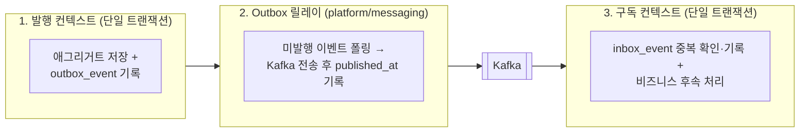

# 컨텍스트 간 통합 (Context Integration)

[strategic/04-context-map.md](../strategic/04-context-map.md)에서 정의한 컨텍스트 간 협력 관계를 실제 코드로 구현하는 규칙을 다룹니다.
단일 JVM의 모듈러 모놀리스로 운영하더라도 컨텍스트 간 통신은 향후 독립 서비스로 분리된 환경을 전제로 설계합니다. 이를 통해 추후 마이크로서비스 분리 시 수정 범위를 번역 계층(ACL) 어댑터 한 곳으로 한정합니다.

## 상호작용 원칙 요약

| 상호작용 유형                       | 통합 방식                                                      | 모듈러 모놀리스에서의 동작 | 마이크로서비스 분리 후 동작            |
| ----------------------------------- | -------------------------------------------------------------- | -------------------------- | -------------------------------------- |
| 타 컨텍스트 데이터 조회             | 상대 컨텍스트 `-api` 모듈의 조회 포트 호출                     | 인메모리 메서드 호출       | HTTP/gRPC 호출 (번역 계층 내부만 교체) |
| 타 컨텍스트에 비동기 후속 처리 위임 | 도메인 이벤트 발행 및 구독                                     | Outbox → Kafka → Inbox     | 동일 (변경 없음)                       |
| 타 컨텍스트의 상태 변경 완료 대기   | 동기 명령 포트 호출 (`04-context-map.md`에 명시된 예외만 허용) | 인메모리 메서드 호출       | HTTP/gRPC 호출 (번역 계층 내부만 교체) |

## 컨텍스트 간 호출 규칙

1. **공개 계약 모듈(`-api`)만 참조**: 상대 컨텍스트의 `-api` 모듈에 선언된 포트 인터페이스만 호출할 수 있습니다. 상대의 `-core` 모듈은 Gradle 의존성에 없으므로 컴파일 타임에 참조가 차단됩니다([01-module-structure.md](01-module-structure.md) 참고).
2. **번역 계층(ACL)으로 호출 지점 단일화**: 상대 컨텍스트를 호출하는 코드는 반드시 번역 계층 한 곳에만 모아 둡니다. 헥사고날은 `adapter/required/<상대>/`, 레이어드는 `infra/client/` 패키지가 이 역할을 맡습니다([02-internal-architecture.md](02-internal-architecture.md) 참고).
3. **외부 모델의 도메인 침투 방지**: 번역 계층은 상대 컨텍스트 `-api`의 DTO를 자기 컨텍스트의 도메인 타입이나 내부 DTO로 변환하여 반환합니다. 번역 계층 바깥(도메인·응용 서비스)에는 상대 컨텍스트의 타입이 노출되지 않아야 합니다.
4. **화면 표시용 조합 분리**: 오직 화면 응답을 만들기 위해 여러 컨텍스트의 데이터를 합치는 작업은 `apps/*`의 `composition` 계층에서 수행합니다. 개별 컨텍스트는 자신의 비즈니스 규칙 검증 목적이 아닌 단순 화면 표시 목적으로 다른 컨텍스트를 호출하지 않습니다.

## 허용하는 의존

아래 표는 컨텍스트 맵([strategic/04-context-map.md](../strategic/04-context-map.md))의 의존 방향과 일치하며, 여기에 명시되지 않은 방향의 의존은 금지합니다. 각 `<컨텍스트>-core/build.gradle.kts`의 의존성 선언은 아래 표와 정확히 일치해야 합니다.

| 컨텍스트       | 동기 호출이 허용된 상대 (`-api`) | 이벤트 구독이 허용된 발행처 (`-api`) |
| -------------- | -------------------------------- | ------------------------------------ |
| `member`       | 없음                             | 없음                                 |
| `publishing`   | `member`, `media`                | 없음                                 |
| `interaction`  | `member`, `publishing`           | `publishing`                         |
| `media`        | 없음                             | 없음                                 |
| `analytics`    | `publishing`                     | 없음                                 |
| `notification` | `interaction`                    | `publishing`, `interaction`          |

> 도메인 이벤트를 구독하려면 발행 측 `-api` 모듈에 정의된 이벤트 페이로드 클래스와 토픽 상수를 참조해야 하므로, 이벤트만 소비하는 경우에도 발행 측 `-api` 모듈을 Gradle 의존성에 추가합니다.

## 동기 조회를 원격 호출처럼 다루기 위한 규칙

모듈러 모놀리스 내부에서는 불필요한 네트워크 오버헤드를 피하기 위해 자기 자신에게 HTTP 요청을 보내지 않고 인메모리 메서드로 호출합니다. 대신 향후 네트워크 호출로 전환하더라도 비즈니스 동작이 달라지지 않도록 다음 규칙을 준수합니다.

| 설계 규칙                                                                        | 이유                                                                                                                                                   |
| -------------------------------------------------------------------------------- | ------------------------------------------------------------------------------------------------------------------------------------------------------ |
| 단건 반복 호출 대신 식별자 컬렉션(`getAll(ids)`)으로 일괄 조회한다               | 서비스 분리 후 단건 반복 호출은 그대로 네트워크 왕복(N+1 문제) 비용으로 직결되기 때문입니다.                                                           |
| 엔티티가 아닌 `-api` 모듈의 직렬화 가능한 불변 DTO만 주고받는다                  | JPA 엔티티와 지연 로딩 프록시는 프로세스 경계를 넘어 전달할 수 없습니다.                                                                               |
| **자신의 쓰기 트랜잭션을 시작하기 전에** 타 컨텍스트 조회를 먼저 완료한다        | 쓰기 트랜잭션 내부에서 조회하면 서비스 분리 후 외부 네트워크 응답을 기다리는 동안 DB 커넥션을 점유하게 되며, 트랜잭션 전파 동작도 달라지기 때문입니다. |
| 조회 포트의 구현체는 자신만의 읽기 전용 트랜잭션(`readOnly = true`)으로 실행한다 | 호출자의 트랜잭션 컨텍스트에 의존하지 않고 독립적으로 동작하도록 보장합니다.                                                                           |
| 상대 컨텍스트의 예외 타입을 번역 계층 밖으로 그대로 전파하지 않는다              | 번역 계층에서 상대의 예외를 잡아 자신의 도메인 예외나 결과 타입으로 변환해야 결합이 전파되지 않습니다.                                                 |
| 상대 컨텍스트 호출 실패 시의 폴백(Fallback) 정책을 유스케이스별로 정의한다       | 서비스 분리 후 타임아웃이나 장애가 발생했을 때 요청 전체를 실패 처리할지, 기본값으로 진행할지 명확한 기준이 필요합니다.                                |

### 코드 예시 1: 출판 컨텍스트가 회원의 계정 상태를 확인하는 흐름 (헥사고날)

```kotlin
// publishing-core: application/required/BloggerStatusPort.kt
// 출판 컨텍스트의 도메인 언어로 포트를 정의합니다 (member 컨텍스트의 존재를 알지 못함).
interface BloggerStatusPort {
    fun canPublish(bloggerId: UUID): Boolean
}

// publishing-core: adapter/required/member/MemberBloggerStatusAdapter.kt
// 출판 컨텍스트 내에서 member-api를 참조하는 유일한 번역 계층(ACL)입니다.
@Component
class MemberBloggerStatusAdapter(
    private val getAccountStatus: GetAccountStatusQuery,   // member-api
) : BloggerStatusPort {
    override fun canPublish(bloggerId: UUID): Boolean =
        getAccountStatus.get(bloggerId).isActive
}

// publishing-core: application/service/PostCommandService.kt
class PostCommandService(
    private val bloggerStatus: BloggerStatusPort,
    private val postRepository: PostRepository,
    private val transactionTemplate: TransactionTemplate,
) : CreatePostUseCase {
    override fun create(command: CreatePostCommand): PostId {
        // 타 컨텍스트 동기 조회는 자신의 쓰기 트랜잭션을 열기 전에 먼저 수행합니다.
        if (!bloggerStatus.canPublish(command.bloggerId)) throw BloggerNotActive(command.bloggerId)

        return transactionTemplate.execute { postRepository.save(Post.create(command)).id }!!
    }
}
```

추후 `member` 컨텍스트를 별도 서비스로 분리하더라도 `PostCommandService`나 도메인 코드는 전혀 수정할 필요 없이 `MemberBloggerStatusAdapter` 내부 구현만 HTTP 클라이언트 호출로 교체하면 됩니다.

### 코드 예시 2: 여러 컨텍스트의 데이터를 조합해 화면 응답을 만드는 흐름 (`apps/api`)

블로그 대시보드(`apps/api`의 `composition/dashboard`, [contexts/analytics/02-implementation.md](../contexts/analytics/02-implementation.md) 참고)나 게시글 상세 화면처럼 여러 컨텍스트의 데이터를 합쳐야 할 때는 `apps/api`의 `composition` 계층에서 각 컨텍스트의 `-api` 포트를 호출해 조합합니다.

```kotlin
// apps/api: composition/PostDetailQuery.kt
@Component
class PostDetailQuery(
    private val getPost: GetPublishedPostQuery,       // publishing-api
    private val getProfiles: GetProfilesQuery,        // member-api
    private val getViewCounts: GetViewCountsQuery,    // analytics-api
    private val getLikeCounts: GetLikeCountsQuery,    // interaction-api
) {
    fun get(blogSlug: String, postSlug: String): PostDetailResponse {
        val post = getPost.get(blogSlug, postSlug)
        val author = getProfiles.getAll(setOf(post.ownerId)).getValue(post.ownerId)
        val views = getViewCounts.getAll(setOf(post.id))[post.id] ?: 0
        val likes = getLikeCounts.getAll(setOf(post.id))[post.id] ?: 0
        return PostDetailResponse.of(post, author, views, likes)
    }
}
```

## 비동기 도메인 이벤트

컨텍스트 간 이벤트는 모듈러 모놀리스 단계에서도 인메모리 이벤트 버스가 아닌 **Transactional Outbox + Kafka + Transactional Inbox** 파이프라인을 통해 전달합니다. 추후 서비스를 분리할 때 메시징 아키텍처를 변경하지 않기 위함입니다.

### 이벤트 전달 파이프라인



전달 보증 수준은 <strong>최소 한 번 전달(At-least-once delivery)</strong>입니다. 릴레이가 Kafka 전송 직후 `published_at`을 업데이트하기 전에 프로세스가 중단되면 동일한 이벤트가 재전송될 수 있으며, 구독 측의 Inbox 테이블이 멱등성(중복 제거)을 보장합니다.

### Transactional Outbox

| 항목        | 규칙                                                                                                                                                                                      |
| ----------- | ----------------------------------------------------------------------------------------------------------------------------------------------------------------------------------------- |
| 테이블 위치 | 발행 컨텍스트 전용 스키마 내부의 `outbox_event` 테이블 ([04-persistence-conventions.md](04-persistence-conventions.md) 참고)                                                              |
| 기록 시점   | 도메인 엔티티의 상태를 변경하는 비즈니스 트랜잭션 안에서 함께 기록하며, 애플리케이션 로직에서 Kafka 브로커를 직접 호출하지 않습니다.                                                      |
| 구현 위치   | 헥사고날은 `application/required`의 이벤트 발행 포트를 `adapter/required/messaging`이 구현하고, 레이어드는 `infra/messaging`이 `platform/messaging`의 `OutboxWriter`를 감싸서 제공합니다. |

```kotlin
// publishing-core: application/service/PostCommandService.kt
@Transactional
fun publish(command: PublishPostCommand) {
    val post = postRepository.get(command.postId)
    post.publish()
    postRepository.save(post)
    events.publish(PostPublished(post.id, post.blogId, post.ownerId))   // 동일 트랜잭션 내에서 outbox_event에 저장
}
```

### Outbox 릴레이 (Relay)

| 항목              | 규칙                                                                                                                                                                                                             |
| ----------------- | ---------------------------------------------------------------------------------------------------------------------------------------------------------------------------------------------------------------- |
| 모듈 및 실행 위치 | `platform/messaging`에 구현되어 있으며, 이벤트를 발행하는 컨텍스트가 기동되는 프로세스(현재 `apps/api`) 내에서 실행됩니다.                                                                                       |
| 폴링 대상         | 각 컨텍스트가 설정 클래스에 등록한 모든 `OutboxSource(스키마명)` 빈을 대상으로 미발행(`published_at IS NULL`) 레코드를 발생 시각 순으로 읽어 Kafka에 전송합니다.                                                 |
| 실행 주기 및 배치 | 이전 폴링 완료 후 `contentria.messaging.relay.interval`(기본값 `1s`) 간격으로 실행되며, 1회 실행 시 스키마당 최대 100건을 처리합니다.                                                                            |
| 동시성 제어       | 다중 인스턴스(Replica) 환경에서도 스키마당 하나의 릴레이만 실행되도록 PostgreSQL 트랜잭션 Advisory Lock(`outbox-relay:<스키마>`)을 획득한 인스턴스만 폴링을 수행합니다(동일 애그리거트 이벤트의 순서 역전 방지). |
| 전송 실패 처리    | 배치 전송 도중 실패하면 직전까지 성공한 레코드의 발행 시각만 반영하고 중단하며, 남은 레코드는 다음 폴링 주기에 원래 순서대로 재시도합니다.                                                                       |
| 보관 및 정리      | 발행 완료 후 7일이 경과한 레코드는 매시간 스케줄러가 삭제합니다(미발행 레코드는 기간과 무관하게 보존).                                                                                                           |

> 향후 트래픽이 증가하여 폴링 방식을 Debezium 등 CDC(Change Data Capture) 도구로 전환하더라도, 발행 및 구독 컨텍스트의 애플리케이션 코드는 변경할 필요가 없습니다.

### Kafka 토픽 설계

| 항목             | 규칙                                                        | 예시                                                                |
| ---------------- | ----------------------------------------------------------- | ------------------------------------------------------------------- |
| 토픽 명명 규칙   | `<컨텍스트>.<애그리거트>`                                   | `publishing.post`, `interaction.comment`                            |
| 토픽 단위        | 동일한 애그리거트에서 발생하는 여러 이벤트를 한 토픽에 담음 | `publishing.post` 토픽에 `PostPublished`, `PostDeleted` 발행        |
| 파티션 메시지 키 | 애그리거트 식별자 (`aggregateId`)                           | 동일한 게시글의 발행·삭제 이벤트가 같은 파티션에 할당되어 순서 보장 |
| 토픽 상수 정의   | 발행 컨텍스트 `-api` 모듈의 `event/<컨텍스트>Topics.kt`     | `PublishingTopics.POST`                                             |

이벤트 종류마다 별도 토픽을 만들면 동일한 애그리거트에 대한 '발행(`PostPublished`)'과 '삭제(`PostDeleted`)' 이벤트가 서로 다른 토픽으로 나뉘어 발생 순서를 보장할 수 없으므로, **애그리거트 단위로 토픽을 구성**합니다.

### 이벤트 메시지 포맷 (Envelope)

메시지 외피는 `platform/messaging`의 `EventEnvelope`을 사용하며(JSON 직렬화 라이브러리에 의존하므로 `shared-kernel`에 두지 않음), 내부 `payload`에는 발행 측 `-api` 모듈에 정의된 이벤트 데이터 클래스가 직렬화되어 담깁니다.

```json
{
  "eventId": "0192f3a1-7c2e-7b10-9a4e-2d6f1c8b5e01",
  "type": "PostPublished",
  "version": 1,
  "occurredAt": "2026-10-18T03:00:00Z",
  "aggregateId": "0192f3a0-1111-7000-8000-000000000001",
  "payload": {
    "postId": "0192f3a0-1111-7000-8000-000000000001",
    "blogId": "0192f39f-2222-7000-8000-000000000002",
    "ownerId": "0192f39e-3333-7000-8000-000000000003"
  }
}
```

| 항목                                 | 규칙                                                                                                       |
| ------------------------------------ | ---------------------------------------------------------------------------------------------------------- |
| 직렬화 포맷                          | JSON                                                                                                       |
| 페이로드 구성                        | 식별자와 구독 측 판단에 필요한 최소한의 값만 포함하며, 도메인 엔티티 전체를 담지 않습니다.                 |
| 하위 호환 변경 (필드 추가)           | 기존 `version`을 그대로 유지하며, 컨슈머는 알지 못하는 신규 필드를 무시합니다.                             |
| 하위 호환 불가 변경 (필드 삭제·변경) | `version` 번호를 올리고, 모든 컨슈머가 새 버전으로 전환될 때까지 구버전과 신버전 이벤트를 함께 발행합니다. |
| 스키마 레지스트리                    | 현재 단계에서는 도입하지 않으며, 추후 마이크로서비스 분리 시점에 도입을 검토합니다.                        |

### 이벤트 컨슈머와 Transactional Inbox

| 항목            | 규칙                                                                                                                                                                                                           | 예시                                    |
| --------------- | -------------------------------------------------------------------------------------------------------------------------------------------------------------------------------------------------------------- | --------------------------------------- |
| 구현 위치       | 구독 컨텍스트의 인바운드 진입점 (헥사고날: `adapter/provided/messaging`, 레이어드: `presentation/messaging`)                                                                                                   |                                         |
| 컨슈머 그룹 ID  | `<구독 컨텍스트>.<컨슈머 식별 이름>`                                                                                                                                                                           | `interaction.post-deleted`              |
| 중복 처리 방지  | 비즈니스 후속 처리와 동일한 트랜잭션 내에서 자기 스키마의 `inbox_event` 테이블에 `(eventId, consumer)`를 기록합니다. 이미 처리된 기록이 있으면 즉시 건너뜁니다.                                                | `interactionInbox`, `notificationInbox` |
| 오프셋 커밋     | DB 트랜잭션이 정상 커밋된 이후에 Kafka 오프셋을 커밋합니다.                                                                                                                                                    |                                         |
| 실패 재시도·DLT | 일시적 오류 시 1초부터 지수 백오프(2배씩 증가, 최대 1분)로 재시도한 뒤에도 실패하면 DLT(Dead Letter Topic)로 격리하여 파티션 블로킹을 방지합니다. 파싱 불가능한 잘못된 포맷은 재시도 없이 즉시 DLT로 보냅니다. | `publishing.post-dlt`                   |
| 이벤트 필터링   | 한 토픽에 여러 이벤트 타입이 들어오므로, 관심 없는 `type`이거나 지원하지 않는 `version`인 메시지는 무시하고 넘깁니다.                                                                                          |                                         |

```kotlin
// interaction-core: presentation/messaging/PostDeletedConsumer.kt (레이어드)
@Component
class PostDeletedConsumer(
    @Qualifier(InteractionInbox.BEAN) private val inbox: Inbox, // 컨텍스트 전용 Inbox 빈 주입
    private val cleanup: PostCleanupService,
) {
    @KafkaListener(topics = [PublishingTopics.POST], groupId = CONSUMER)
    fun on(message: String) {
        val envelope = EventEnvelope.parse(message)
        if (envelope.type != PostDeleted.TYPE || envelope.version != PostDeleted.VERSION) return
        inbox.processOnce(envelope.eventId, CONSUMER) {
            cleanup.removeAllFor(envelope.payloadAs<PostDeleted>().postId)  // inbox_event 기록과 단일 트랜잭션으로 실행
        }
    }
}
```

### Kafka 파이프라인을 사용하지 않는 예외 케이스

| 케이스                                                  | 처리 방식                                                                                                 |
| ------------------------------------------------------- | --------------------------------------------------------------------------------------------------------- |
| 동일한 컨텍스트 내부에서의 후속 처리                    | 동일 트랜잭션 내에서 직접 호출하거나, 컨텍스트 내부의 Spring ApplicationEvent로 처리합니다.               |
| 미디어 컨텍스트의 영상 변환 작업 큐 (Cloudflare Queues) | 컨텍스트 간 도메인 이벤트가 아니라 미디어 컨텍스트 내부의 외부 인프라 연동이므로 본 절의 대상이 아닙니다. |

## 트랜잭션 경계

**하나의 데이터베이스 트랜잭션에는 단일 컨텍스트의 쓰기 작업만 포함합니다.**
현재 모듈러 모놀리스 1단계에서는 단일 `DataSource`를 공유하므로 기술적으로는 여러 컨텍스트의 테이블을 한 트랜잭션으로 묶을 수 있지만, 이를 엄격히 금지합니다. 다중 컨텍스트 트랜잭션에 의존하는 코드는 향후 서비스를 분리하는 순간 깨지기 때문입니다.

### 컨텍스트 간 일관성이 필요할 때의 의사결정 순서

| 검토 순서 | 판단 질문                                                    | 해결 방식                                                                                                          |
| --------- | ------------------------------------------------------------ | ------------------------------------------------------------------------------------------------------------------ |
| 1         | 정말로 밀리초 단위의 즉시 일관성이 필수적인가?               | 대부분의 후속 처리는 수 초 내의 결과적 일관성(Eventual Consistency)으로 충분하므로 **도메인 이벤트**로 처리합니다. |
| 2         | 두 컨텍스트에 걸친 핵심 비즈니스 불변식인가?                 | 컨텍스트 경계가 잘못 설정되었다는 신호이므로, 관련 데이터와 규칙을 **하나의 컨텍스트로 통합**합니다.               |
| 3         | 쓰기 전에 단순히 다른 컨텍스트의 상태만 검증하면 되는가?     | **트랜잭션 시작 전에 동기 조회**로 상태를 확인한 뒤, 자신의 로컬 트랜잭션에서 쓰기를 수행합니다.                   |
| 4         | 여러 컨텍스트에 걸친 상태 변경을 순차적으로 조율해야 하는가? | **사가(Saga) 패턴** 또는 정리 가능한 작업 순서 설계로 해결합니다.                                                  |

> 3번 방식의 경우 상태 조회 직후와 로컬 트랜잭션 커밋 사이의 아주 짧은 찰나에 상대 컨텍스트의 상태(예: 계정 정지)가 바뀔 수 있으나, 이 수준의 미세한 경쟁 상태는 허용하고 필요 시 이벤트로 사후 보정합니다.

### 사가(Saga) 및 실패 복구 설계 원칙

- 분산 2단계 커밋(2PC / XA 트랜잭션)은 사용하지 않습니다.
- 각 단계는 해당 컨텍스트의 독립된 로컬 트랜잭션으로 실행합니다.
- 중간 단계가 실패했을 때 앞 단계를 명시적으로 보상(Compensation)하거나, **실패하더라도 데이터 정합성이 깨지지 않고 배치 잡으로 정리 가능한 부산물만 남도록 실행 순서**를 설계합니다.

### 설계 예시: 게시글 저장과 미디어 파일 연결 동기화

신규 아키텍처에서는 이미지 업로드 시점부터 파일 URL이 고정되며 게시글 저장 시 스토리지의 파일을 이동시키지 않습니다([contexts/media/01-rules.md](../contexts/media/01-rules.md) 참고). 따라서 게시글 저장과 미디어 연결은 다음 두 단계의 독립된 로컬 트랜잭션으로 실행됩니다.

1. **출판 컨텍스트 (출판 로컬 트랜잭션)**: 게시글 본문을 저장합니다.
2. **미디어 컨텍스트 (미디어 로컬 트랜잭션)**: 본문에 포함된 이미지 URL 목록을 전달받아 게시글과의 연결 상태를 동기화합니다.
   - 만약 2단계가 일시적 오류로 실패하더라도 게시글 본문 자체는 이미 정상 저장되어 있습니다.
   - 연결 정보가 반영되지 않은 이미지는 다음 게시글 수정 시 다시 동기화되거나, 7일간 어떤 게시글에도 연결되지 않으면 미사용 파일 정리 배치에 의해 삭제됩니다.

이처럼 중간 실패가 치명적인 데이터 손상 대신 '추후 정리 가능한 상태'만 남기도록 순서를 배치하면 복잡한 롤백 보상 트랜잭션이 필요하지 않습니다.

## 데이터베이스 참조 규칙

컨텍스트마다 독립된 PostgreSQL 스키마를 사용하며, 다른 컨텍스트의 스키마를 SQL(`JOIN`, 서브쿼리 등)로 직접 조회하거나 수정하지 않습니다. 타 컨텍스트의 데이터는 오직 해당 컨텍스트의 `-api` 포트를 통해서만 얻습니다([04-persistence-conventions.md](04-persistence-conventions.md) 참고).

### JPA 연관관계 매핑

컨텍스트 경계를 넘는 JPA 객체 연관관계(`@ManyToOne`, `@OneToMany` 등)는 사용하지 않으며, 반드시 **식별자(ID) 값**으로만 참조합니다.

```kotlin
// 금지: 타 컨텍스트(또는 다른 애그리거트) 엔티티를 직접 매핑
@ManyToOne
val owner: Account

// 권장: 식별자(UUID) 컬럼으로만 참조
@Column(name = "owner_id")
val ownerId: UUID
```

동일한 컨텍스트 내부라 하더라도 서로 다른 애그리거트 루트 간에는 객체 참조 대신 식별자(ID)로만 참조합니다. 애그리거트 하나가 곧 트랜잭션 일관성의 경계이기 때문입니다.

### 외래키

**서로 다른 애그리거트 간에는 물리적 데이터베이스 외래키(FK)를 두지 않습니다.** 이는 다른 컨텍스트의 테이블뿐 아니라 같은 컨텍스트 내의 다른 애그리거트 테이블에 대해서도 동일하게 적용됩니다.

- 타 컨텍스트 스키마를 가리키는 외래키는 DB 수준에서 두 컨텍스트를 강하게 결합시킵니다.
- `ON DELETE CASCADE`나 `SET NULL`로 타 컨텍스트의 데이터가 암묵적으로 변경·삭제되는 것은 도메인 계층을 우회하는 숨은 결합입니다. 연쇄 처리가 필요한 경우에는 컨텍스트 맵에 정의된 동기 호출이나 도메인 이벤트로 명시적으로 처리합니다.
- 단, **동일한 애그리거트 내부**의 루트 엔티티와 소속 엔티티 간(예: `credentials.account_id → accounts.id`)에는 물리적 외래키를 정상적으로 사용합니다.

## 다중 컨텍스트 조회 성능

목록 화면을 조합할 때 단건 조회를 반복하면 N+1 문제가 발생하므로, 모든 다건 조회 포트는 식별자 컬렉션을 받는 배치 조회 형태(`getAll(ids: Set<UUID>)`)로 설계합니다.

추후 트래픽 증가로 인해 실제 성능 병목이 측정될 경우에만 다음 최적화를 검토합니다(사전 최적화 지양).

- **로컬 읽기 모델(Read Model) 복제**: 타 컨텍스트의 도메인 이벤트를 구독하여 조회·정렬에 필요한 최소한의 필드를 자기 스키마의 읽기 전용 테이블에 복제합니다.
- **CQRS 조회 전용 모델 분리**: 복잡한 통계나 검색 요구사항을 처리하기 위해 도메인 모델과 분리된 조회 전용 저장소를 구성합니다.

## 통합 규칙의 강제 수단

| 통합 규칙                                          | 강제 수단                                                                                                 |
| -------------------------------------------------- | --------------------------------------------------------------------------------------------------------- |
| 허용된 컨텍스트 `-api`만 참조                      | 각 `<컨텍스트>-core/build.gradle.kts`의 의존성 선언으로 제한                                              |
| 타 컨텍스트의 `-core` 내부 구현 참조 금지          | Gradle 모듈 의존성 미선언 (컴파일 타임 차단)                                                              |
| 번역 계층(ACL) 외부에서 타 컨텍스트 타입 사용 금지 | ArchUnit 테스트 ([02-internal-architecture.md](02-internal-architecture.md) 참고)                         |
| 단일 트랜잭션 내 다중 컨텍스트 쓰기 금지           | 코드 리뷰 및 트랜잭션 경계 분리 (추후 2단계에서 컨텍스트별 `DataSource`·트랜잭션 매니저 분리로 물리 강제) |
