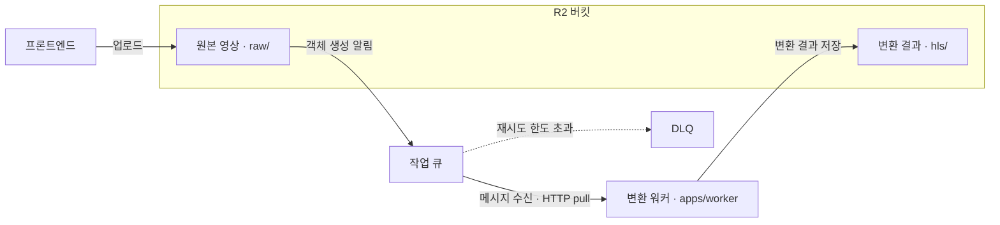

# 영상 변환 파이프라인 설정

영상 변환에 필요한 Cloudflare 자원과 워커의 연결 설정, 동작 확인 방법을 설명합니다.

## 개요

프론트엔드가 원본을 R2에 업로드하면 R2 이벤트 알림이 Cloudflare Queues로 전달됩니다. 백엔드의 `apps/worker`는 HTTP pull 방식으로 메시지를 가져와 영상을 변환하고, 결과를 같은 R2 버킷에 저장합니다.



메시지 재전달과 재시도 한도 관리는 큐가 담당하며, 별도의 Cloudflare Worker는 사용하지 않습니다. 영상의 상태 전이와 변환 규칙은 [미디어 도메인 규칙](../contexts/media/01-rules.md), 코드 구성은 [미디어 구현 구조](../contexts/media/02-implementation.md)를 참고합니다.

## 환경 구성

### 사전 준비

설정을 시작하기 전에 다음 항목을 준비합니다.

- 원본과 변환 결과를 저장할 R2 버킷 및 공개 주소
- 해당 버킷의 객체를 읽고 쓸 수 있는 R2 자격증명
- Cloudflare 자원을 설정할 수 있는 계정과 인증된 `wrangler` 실행 환경
- 워커가 접속할 PostgreSQL 데이터베이스 및 마이그레이션이 완료된 스키마

개발 환경과 운영 환경은 버킷과 큐를 각각 분리합니다. 개발 워커가 운영 큐를 조회하면 개발 DB에 없는 영상의 메시지를 변환 없이 처리 완료(ack)할 수 있습니다.

### 원본 보관 기간 설정

R2 버킷의 수명 규칙에서 `raw/` 객체가 **7일 뒤 만료**되도록 설정합니다. 워커는 변환 성공 시 원본을 직접 삭제하며, 수명 규칙은 실패하거나 중단된 작업의 원본이 계속 남는 것을 방지합니다.

### 큐 생성

작업 큐는 원본 업로드 알림을 받고, DLQ(Dead Letter Queue)는 재시도 한도를 초과한 메시지를 보관합니다. 아래 큐 이름은 예시이며 환경에 맞게 변경할 수 있습니다.

```bash
wrangler queues create contentria-video-transcode
wrangler queues create contentria-video-transcode-dlq
```

작업 큐를 생성한 뒤 큐 ID를 기록합니다. 이 값은 [워커 설정](#워커-설정)의 `CF_QUEUE_ID`에 사용합니다.

### HTTP pull 소비자 연결

작업 큐에 `http_pull` 소비자를 연결하고 재시도 횟수, 가시성 타임아웃, DLQ를 지정합니다.

```bash
wrangler queues consumer http add contentria-video-transcode \
  --message-retries 3 \
  --visibility-timeout-secs 1800 \
  --dead-letter-queue contentria-video-transcode-dlq
```

`--message-retries 3`은 처리에 실패한 메시지의 재시도 한도입니다. 한도를 초과한 메시지는 DLQ로 이동합니다. 가시성 타임아웃은 소비자가 가져간 메시지를 다른 소비자에게 다시 전달하지 않는 시간이며, 여기서는 30분으로 설정합니다.

워커도 메시지를 가져올 때 30분의 가시성 타임아웃을 요청합니다. 변환 중인 메시지가 재전달되지 않도록 이 시간은 다운로드·변환·업로드를 포함한 작업 시간보다 길어야 합니다. 명령 옵션은 [Cloudflare Queues 명령 참조](https://developers.cloudflare.com/workers/wrangler/commands/queues/)에서 확인할 수 있습니다.

### R2 이벤트 알림 연결

원본 경로인 `raw/`에 객체가 생성되면 작업 큐로 알림을 보내도록 설정합니다. `<R2_BUCKET_NAME>`은 준비한 버킷 이름으로 바꿉니다.

```bash
wrangler r2 bucket notification create <R2_BUCKET_NAME> \
  --event-type object-create \
  --prefix raw/ \
  --queue contentria-video-transcode
```

**`raw/` 접두사 필터를 반드시 지정합니다.** 변환 결과가 저장되는 `hls/`에서도 객체 생성 이벤트가 발생하므로, 필터가 없으면 결과 파일의 알림까지 작업 큐에 쌓입니다. 워커에서도 `raw/` 외의 경로를 제외하지만, R2에서 먼저 알림 대상을 제한합니다.

이벤트 설정 옵션은 [R2 이벤트 알림 문서](https://developers.cloudflare.com/r2/buckets/event-notifications/)를 참고합니다.

### 워커용 API 토큰 발급

메시지 조회와 처리 완료 응답(ack)에 사용할 API 토큰을 발급합니다. 권한은 **Account → Queues → Edit**로 지정하고 대상 계정으로 범위를 제한합니다.

이 토큰은 R2 객체 접근용 자격증명과 별개이며, 워커의 `CF_API_TOKEN`으로 전달합니다. 운영 환경에서는 Kubernetes Secret 등 비밀값 저장 수단으로 관리합니다.

### 워커 설정

[워커 환경 변수 예시](../../apps/worker/.env.sample)를 기준으로 데이터베이스, R2, 큐 연결 정보를 준비합니다. 큐 관련 값은 앞에서 설정한 버킷·큐와 같은 환경을 가리켜야 합니다.

| 환경 변수                     | 설정 내용                                  |
| ----------------------------- | ------------------------------------------ |
| `CLOUDFLARE_ACCOUNT_ID`       | 작업 큐가 속한 Cloudflare 계정 ID          |
| `CF_QUEUE_ID`                 | 작업 큐 ID (큐 이름이나 DLQ ID가 아님)     |
| `CF_API_TOKEN`                | Queues Edit 권한으로 발급한 API 토큰       |
| `WORKER_POLL_INTERVAL`        | 메시지 조회 간격. 기본값 `5s`              |
| `FFMPEG_PATH`, `FFPROBE_PATH` | 변환 도구 경로. 기본값 `ffmpeg`, `ffprobe` |

[워커 설정 파일](../../apps/worker/src/main/resources/application.yml)에서 위 값을 읽습니다. 워커는 기본적으로 메시지를 한 번에 1개씩 가져오며, 가시성 타임아웃은 30분입니다.

연결 정보를 설정한 뒤 워커를 실행합니다. 워커 이미지에는 ffmpeg와 ffprobe가 포함되어 있으며, 실행 방법은 [컨테이너 이미지 운영](container-images.md)을 참고합니다.

## 동작 검증

개발 환경에서 다음 순서로 확인합니다. 단순히 R2에 파일을 넣으면 영상의 DB 기록이 없어 변환되지 않으므로, 애플리케이션의 영상 업로드 기능을 사용합니다.

### 영상 처리

1. 작은 영상을 업로드하고 `raw/`에 원본이 생성되는지 확인합니다. Cloudflare 대시보드에서 작업 큐의 메시지 유입도 확인합니다.
2. 워커가 메시지를 처리한 뒤 `hls/`에 HLS 파일과 poster가 생성되고 원본이 삭제되는지 확인합니다. 애플리케이션에서도 영상이 재생되는지 확인합니다.
3. `hls/` 객체 생성으로 작업 큐에 추가 메시지가 유입되지 않는지 확인합니다.

### 실패 처리

개발 환경에서 저장소 접근 실패 같은 일시 오류를 발생시킨 뒤 다음 순서로 확인합니다.

1. 워커 로그에서 메시지 처리 실패를 확인합니다.
2. 처리 완료되지 않은 메시지가 가시성 타임아웃 이후 재전달되는지 확인합니다.
3. 오류가 지속되어 재시도 한도를 초과하면 메시지가 DLQ로 이동하는지 확인합니다.

## 장애 대응

### 메시지 처리 기준

워커는 R2 알림의 `object.key`와 `action`을 읽습니다. 객체 키를 DB의 `videos.raw_key`와 대조하며, 처리 결과에 따라 다음과 같이 응답합니다.

| 처리 결과                                                                                                        | 큐 응답 및 후속 동작                                                                       |
| ---------------------------------------------------------------------------------------------------------------- | ------------------------------------------------------------------------------------------ |
| 변환 성공                                                                                                        | 메시지를 처리 완료(ack)합니다.                                                             |
| 영구 실패 (영상 형식이 아니거나 길이가 5분을 초과함)                                                             | 영상을 실패 상태로 변경하고 ack합니다. 동일 입력을 재시도하지 않습니다.                    |
| 일시 실패 (네트워크·저장소 오류 등)                                                                              | ack하지 않습니다. 가시성 타임아웃 이후 재전달되며 재시도 한도를 초과하면 DLQ로 이동합니다. |
| 변환 대상 아님 (`raw/` 외 경로, `PutObject`·`CompleteMultipartUpload` 외의 작업, DB 기록 없음, 이미 처리한 영상) | 변환 없이 ack합니다.                                                                       |

### 증상별 확인 항목

| 증상                                       | 확인할 항목                                                                          |
| ------------------------------------------ | ------------------------------------------------------------------------------------ |
| 업로드했지만 큐에 메시지가 없음            | 업로드 버킷, R2 알림의 대상 큐, `object-create` 이벤트와 `raw/` 필터를 확인합니다.   |
| 워커가 메시지를 가져오지 못함              | 워커 로그와 계정 ID·큐 ID, API 토큰의 권한을 확인합니다.                             |
| 메시지는 처리되었지만 영상이 변환되지 않음 | 해당 객체 키의 DB 기록이 있는지, 워커의 DB·버킷·큐가 같은 환경인지 확인합니다.       |
| 메시지가 반복 전달되거나 DLQ로 이동함      | 워커 로그에서 실패 원인을 찾고 DB·R2 연결, 변환 도구, 임시 디스크 공간을 확인합니다. |

진단 목적으로 메시지를 직접 pull하면 해당 메시지는 가시성 타임아웃 동안 워커에 전달되지 않습니다. 큐 유입 여부만 확인할 때는 대시보드의 지표를 우선 사용합니다.
