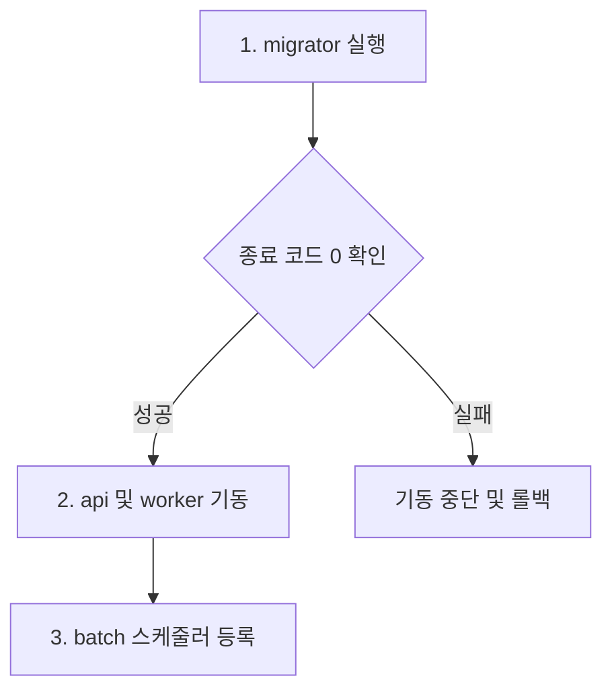

# 컨테이너 이미지 운영

백엔드 애플리케이션의 컨테이너 이미지 구성, 빌드 절차 및 컨테이너 구동 요구사항을 설명합니다.

## 개요

### 배포 대상

`api`, `worker`, `batch`, `migrator`는 각각 독립된 컨테이너 이미지로 패키징하여 배포합니다. 각 애플리케이션이 사용하는 컨텍스트 및 플랫폼 모듈은 실행 JAR에 포함됩니다.

| 애플리케이션 | 역할                                                             | 주요 외부 의존성                       |
| ------------ | ---------------------------------------------------------------- | -------------------------------------- |
| `api`        | HTTP 요청을 처리하는 상주 서버 (포트 `8080`, context path `/api`) | PostgreSQL, Kafka, R2                  |
| `worker`     | 영상 변환 메시지를 조회하고 처리하는 상주 프로세스               | PostgreSQL, R2, Cloudflare Queues      |
| `batch`      | 지정된 잡을 실행한 뒤 종료되는 일회성 프로세스                   | PostgreSQL, R2                         |
| `migrator`   | 컨텍스트별 Flyway 마이그레이션을 적용한 뒤 종료되는 프로세스     | PostgreSQL, 컨텍스트별 마이그레이션 롤 |

### 이미지 구성

Dockerfile은 `backend/apps/<앱>/Dockerfile`에 위치하며, 빌드 컨텍스트는 `backend/`입니다. **컨테이너 내부에서는 Gradle 빌드를 수행하지 않으므로 실행 JAR를 사전에 생성해야 합니다.**

| 항목           | 세부 구성                                                                                         |
| -------------- | ------------------------------------------------------------------------------------------------- |
| 입력 파일      | `apps/<앱>/build/libs/application.jar` (`.dockerignore`를 통해 해당 JAR 파일만 컨텍스트에 포함)    |
| 기반 이미지    | `eclipse-temurin:25-jre-noble` (`JRE_IMAGE` 빌드 인자로 재정의 가능)                             |
| 레이어 추출    | 빌드 머신 환경에서 Spring Boot JAR의 계층화된 레이어를 사전 추출하여 캐싱 효율을 극대화합니다.    |
| 실행 계정      | 최소 권한 원칙에 따라 non-root UID/GID `10001:10001`로 구동합니다.                                |
| 워커 추가 패키지 | ffmpeg, ffprobe 및 프로세스 종료 시그널 전파를 위한 tini를 포함합니다.                            |

## 이미지 빌드

### 로컬 빌드

JDK 25 및 BuildKit을 지원하는 Docker 환경이 필요합니다. 아래 명령은 **저장소 루트**에서 수행합니다.

1. 네 개 애플리케이션의 실행 JAR를 먼저 생성합니다.
```bash
(cd backend && ./gradlew :apps:api:bootJar :apps:batch:bootJar :apps:worker:bootJar :apps:migrator:bootJar)
```

2. 생성된 JAR를 기반으로 이미지를 빌드합니다.
```bash
for app in api batch worker migrator; do
  docker build -f "backend/apps/$app/Dockerfile" -t "contentria/$app:local" backend/
done
```

- 소스코드가 변경되면 JAR 생성 단계부터 다시 수행해야 최신 변경사항이 이미지에 반영됩니다.
- 타 아키텍처용 빌드 시 `--platform linux/amd64`와 같이 명시하며, 에뮬레이션 환경(QEMU 등)이 필요합니다.

### CI 자동 빌드

[Backend images 워크플로](../../../.github/workflows/backend-images.yml)는 `main` 브랜치에 `backend/` 코드 또는 워크플로 변경사항이 병합되면 자동으로 실행됩니다.

1. `./gradlew build --continue`로 전체 테스트를 수행하고 네 애플리케이션의 JAR를 빌드합니다.
2. 테스트가 성공하면 멀티 아키텍처(`linux/amd64`, `linux/arm64`) 이미지를 빌드하여 GitHub Container Registry(GHCR)에 푸시합니다.

### 태그 정책

이미지 게시 경로는 `ghcr.io/<소유자>/contentria-<앱>` 형식입니다. (예: `ghcr.io/seung7642/contentria-api`)

| 태그 규칙            | 용도 및 특징                                                                    |
| -------------------- | ------------------------------------------------------------------------------- |
| `sha-<커밋 앞 12자>` | 특정 소스 커밋에 고정된 배포 이미지를 지정할 때 사용합니다. (배포 환경 기본 권장) |
| `latest`             | 가장 최근에 빌드된 이미지를 가리키며, 새로운 빌드 시 대상이 갱신됩니다.          |

## 컨테이너 구동 요구사항

백엔드 컨테이너 이미지가 런타임(Docker 또는 Kubernetes)에서 정상 동작하기 위해 만족해야 하는 환경 계약(Contract)입니다.

### 환경 변수 주입

- 각 앱의 `.env.sample`을 기준으로 환경 설정을 구성합니다.
- `.env` 파일이나 비밀키를 이미지 내부에 포함하지 않습니다. 로컬 환경에서는 `--env-file`, Kubernetes에서는 Secret 및 ConfigMap으로 환경 변수를 주입합니다.
- 컨테이너 내부의 `localhost`는 격리된 컨테이너 자신을 가리키므로, 외부 인프라(DB, Kafka 등) 연결 시 컨테이너에서 접근 가능한 DNS 또는 서비스 IP를 지정합니다.

### 보안 실행 권한

- 모든 이미지는 비루트 사용자 `10001:10001`로 패키징되어 있습니다.
- Kubernetes 매니페스트 구성 시 `securityContext.runAsNonRoot: true`를 지정하여 비루트 실행을 강제합니다.

### 파일 시스템 제약

- 컨테이너 런타임에서 `readOnlyRootFilesystem: true` 설정을 지원하도록 설계되었습니다.
- 임시 파일 작성이 필요한 디렉터리(`/tmp`)에는 쓰기 가능한 임시 파일 시스템(`tmpfs` 또는 Kubernetes `emptyDir`)을 마운트해야 합니다.
- `worker`는 영상 다운로드 및 HLS 트랜스코딩 결과물을 임시 디렉터리에 보관하므로 충분한 용량의 `ephemeral-storage`를 할당해야 합니다.

### 컨테이너 기동 순서

서비스 기동 시 의존성 충돌을 방지하기 위해 다음 순서로 컨테이너를 구동해야 합니다.



1. **`migrator` 실행**: 데이터베이스 스키마 마이그레이션을 우선 적용합니다.
2. **종료 상태 검증**: `migrator`가 종료 코드 `0`으로 성공한 것을 확인한 후 다음 단계로 진행합니다. 실패 시 후속 애플리케이션 구동을 중단합니다.
3. **`api` 및 `worker` 실행**: 상주 프로세스를 기동합니다.
4. **`batch` 등록**: 필요한 배치 작업을 Job 또는 CronJob으로 스케줄링합니다.

### 배치 잡 구동 방식

`batch` 이미지는 컨테이너 실행 인자로 잡 이름을 전달받아 실행된 후 프로세스가 종료됩니다.

```bash
docker run --rm --read-only --tmpfs /tmp:rw,mode=1777 \
  --env-file backend/apps/batch/.env contentria/batch:local \
  --spring.batch.job.name=analyticsDailyStatistics
```

| 잡 이름                    | 수행 작업           |
| -------------------------- | ------------------- |
| `mediaImageCleanup`        | 미디어 이미지 정리  |
| `mediaVideoCleanup`        | 미디어 영상 정리    |
| `analyticsDailyStatistics` | 일별 방문 통계 집계 |

## 동작 검증

### 앱별 정상 동작 기준

| 대상       | 검증 항목                                                                                                      |
| ---------- | -------------------------------------------------------------------------------------------------------------- |
| `migrator` | 스키마 마이그레이션 성공 여부, 종료 코드 `0` 확인, 멱등 재실행 시 정상 종료                                    |
| `api`      | 공개 API 응답 확인, 인증 실패 시 401 응답 및 인가 제어 정상 여부                                               |
| `batch`    | 지정된 잡의 실행 완료(COMPLETED) 상태 및 데이터 결과 반영 확인                                                  |
| `worker`   | 큐 메시지 수신, HLS 트랜스코딩 완료 및 R2 업로드 확인 ([파이프라인 동작 검증](cloudflare-video-pipeline.md#동작-검증) 참고) |

### 헬스 체크 현황

현재 백엔드 애플리케이션에는 Spring Actuator 기반의 헬스 엔드포인트가 구성되어 있지 않습니다.
Kubernetes liveness/readiness probe를 적용하기 전 별도의 헬스 체크 엔드포인트 구현이 선행되어야 합니다.
