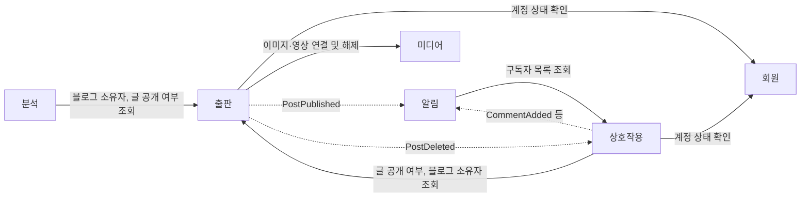

# 컨텍스트 맵 (Context Map)

[03-bounded-contexts.md](03-bounded-contexts.md)에서 정의한 바운디드 컨텍스트들이 서로 어떤 데이터를 주고받으며 협력하는지 기록합니다.

## 핵심 원칙

1. **컨텍스트 간 직접 호출은 자신의 도메인 규칙(불변식)을 검증하는 데 필요한 경우로만 제한합니다.**
   - 단순히 화면 렌더링을 위해 여러 컨텍스트의 데이터를 합치는 작업은 컨텍스트 내부가 아니라 진입점 계층에서 수행합니다(아래 `조회 조합` 참고).
   - 예시: 출판 컨텍스트는 글을 작성하려는 회원이 활성 상태인지 검증해야 하므로 회원 컨텍스트를 호출합니다. 반면 작성자의 표시 이름은 출판의 도메인 규칙과 무관하므로 출판 컨텍스트가 조회하지 않습니다.
2. **의존 방향은 단방향으로 유지합니다.**
   - 두 컨텍스트가 서로를 호출하는 양방향(순환) 의존은 허용하지 않습니다.
3. **즉시 일관성이 필요하지 않은 후속 처리는 도메인 이벤트로 비동기 전파합니다.**
4. **하류(Downstream) 컨텍스트는 상류(Upstream)의 모델을 자신의 도메인 언어로 번역하여 사용합니다.**
   - 상류 컨텍스트의 타입이 하류 도메인 모델 내부로 직접 침투하지 않도록 격리합니다.

## 컨텍스트 간 관계 패턴

| 패턴 명칭                                   | 이 문서에서의 의미                                                                                                 |
| ------------------------------------------- | ------------------------------------------------------------------------------------------------------------------ |
| 공개 호스트 서비스 (OHS, Open Host Service) | 상류 컨텍스트가 여러 하류 컨텍스트를 위해 제공하는 표준화된 공개 인터페이스로, 상류의 내부 구현 모델은 은닉합니다. |
| 부패 방지 계층 (ACL, Anti-Corruption Layer) | 하류 컨텍스트가 상류 인터페이스를 호출할 때 상류의 모델을 자신의 도메인 개념으로 변환하는 격리 계층입니다.         |
| 고객-공급자 (Customer-Supplier)             | 하류(고객)의 요구사항에 맞춰 상류(공급자)가 전용 기능을 설계·제공하는 관계입니다.                                  |
| 공표된 언어 (Published Language)            | 이벤트 발행 측이 정의한 표준 도메인 이벤트 스키마로, 구독 측이 이를 기반으로 이벤트를 소비합니다.                  |
| 공유 커널 (Shared Kernel)                   | 모든 컨텍스트가 함께 참조하는 최소한의 공통 기술 기반 모듈로, 비즈니스 도메인 개념은 포함하지 않습니다.            |

## 전체 컨텍스트 관계도

- **실선(`-->`)**: 동기 호출 및 의존 방향 (하류 → 상류)
- **점선(`-.->`)**: 비동기 도메인 이벤트 흐름 (발행 → 구독)
- 분석 컨텍스트는 유효 방문 여부를 판단하기 위해 출판 컨텍스트를 단방향으로 조회할 뿐, 도메인 이벤트는 주고받지 않습니다.

| 상류 (제공 측) | 하류 (사용 측) | 관계 패턴                        | 하류가 얻는 정보·기능                                       | 통신 방식                       |
| -------------- | -------------- | -------------------------------- | ----------------------------------------------------------- | ------------------------------- |
| 회원           | 출판           | 공개 호스트 서비스 + 하류 ACL    | 블로거가 글을 작성할 수 있는 활성 계정 상태인지 여부        | 동기 조회                       |
| 회원           | 상호작용       | 공개 호스트 서비스 + 하류 ACL    | 회원이 구독·댓글·좋아요를 수행할 수 있는 활성 상태인지 여부 | 동기 조회                       |
| 미디어         | 출판           | 고객-공급자 (출판이 고객)        | 게시글 본문 이미지 및 첨부 영상의 연결 동기화·해제          | 동기 호출                       |
| 출판           | 상호작용       | 고객-공급자 (상호작용이 고객)    | 블로그·게시글의 존재 및 공개 여부, 블로그 소유자 식별자     | 동기 조회, `PostDeleted` 이벤트 |
| 상호작용       | 알림           | 공개 호스트 서비스 + 공표된 언어 | 특정 블로그의 구독자 목록, 댓글 작성 등 상호작용 이벤트     | 동기 조회, 비동기 이벤트        |
| 출판           | 알림           | 공표된 언어                      | 게시글 발행 이벤트                                          | 비동기 이벤트                   |
| 출판           | 분석           | 공개 호스트 서비스 + 하류 ACL    | 블로그 소유자 식별자, 게시글 소속 블로그 및 공개 여부       | 동기 조회                       |
| 공유 커널      | 전체 컨텍스트  | 공유 커널                        | 식별자(UUID/TSID 등) 생성, 공통 예외, 영속성 기반 클래스    | 공통 라이브러리                 |

### 출판과 미디어의 의존 방향 설계

- **게시글 저장 시**: 마크다운 본문 문법은 출판 컨텍스트가 소유하므로 미디어 컨텍스트는 본문을 직접 파싱하지 않습니다. 출판 컨텍스트가 본문에서 참조된 미디어 파일 목록을 추출하여 미디어 컨텍스트에 전달합니다.
- **게시글 삭제 시**: 미디어가 출판의 삭제 이벤트를 구독하는 대신, 출판이 미디어를 동기 호출하여 파일 연결을 해제합니다. 이미 출판이 미디어를 호출하는 의존 관계(`출판 → 미디어`)가 존재하므로, 미디어가 출판의 이벤트를 구독하게 되면 양방향 결합이 생기기 때문입니다.

## 도메인 이벤트

컨텍스트 경계를 넘어 전달되는 도메인 이벤트 목록입니다 (회원 컨텍스트 내부에서만 쓰이는 이벤트는 [contexts/member/02-implementation.md](../contexts/member/02-implementation.md)에 정의되어 있습니다).

| 이벤트             | 발행 컨텍스트 | 구독 컨텍스트 | 구독 측의 후속 처리                               | 상태                                                                         |
| ------------------ | ------------- | ------------- | ------------------------------------------------- | ---------------------------------------------------------------------------- |
| `PostPublished`    | 출판          | 알림          | 해당 블로그의 구독자들에게 새 글 알림 생성        | 확정                                                                         |
| `PostDeleted`      | 출판          | 상호작용      | 삭제된 게시글에 달린 댓글과 좋아요 정리           | 확정                                                                         |
| `CommentAdded`     | 상호작용      | 알림          | 게시글이 속한 블로그 소유자에게 새 댓글 알림 생성 | 확정                                                                         |
| `PostLiked`        | 상호작용      | 알림          | 블로그 소유자에게 좋아요 알림 생성                | 보류 ([notification/01-rules.md](../contexts/notification/01-rules.md) 참고) |
| `BlogSubscribed`   | 상호작용      | 알림          | 블로그 소유자에게 신규 구독 알림 생성             | 보류 (위와 동일)                                                             |
| `AccountSuspended` | 회원          | 출판          | 정지된 회원의 블로그 및 게시글 노출 제한 처리     | 미정                                                                         |

- 이벤트 페이로드에는 식별자와 구독 측이 처리를 판단하는 데 필요한 최소한의 속성만 담습니다.
  - _예시_: `CommentAdded` 이벤트에는 알림 수신자를 즉시 특정할 수 있도록 블로그 소유자 ID를 함께 담습니다(상호작용 컨텍스트는 댓글 작성 시점에 이미 출판 컨텍스트를 통해 블로그 소유자를 확인했기 때문입니다).
- 영상 변환 완료 및 실패는 미디어 컨텍스트 내부의 상태 전이이므로 컨텍스트 간 도메인 이벤트에 포함되지 않습니다.

## 동기 호출

비동기 이벤트로 대체할 수 없어 동기 호출로 처리하는 작업 목록입니다.

| 호출 경로 및 내용                                              | 동기 호출이 필요한 이유                                                                                                                                                            |
| -------------------------------------------------------------- | ---------------------------------------------------------------------------------------------------------------------------------------------------------------------------------- |
| **출판 → 미디어**: 게시글 이미지·첨부 영상 연결 동기화 및 해제 | 게시글 저장·삭제 직후 즉시 연결 상태가 반영되어야 미사용 파일 정리 배치가 사용 중인 이미지를 오삭제하지 않습니다. 또한 의존 방향을 `출판 → 미디어` 단방향으로 일관되게 유지합니다. |
| **출판 → 회원**: 계정 상태 확인                                | 정지되거나 탈퇴한 계정은 글을 작성할 수 없으므로 저장 전에 즉시 검증해야 합니다.                                                                                                   |
| **상호작용 → 회원**: 계정 상태 확인                            | 위와 동일합니다.                                                                                                                                                                   |
| **상호작용 → 출판**: 게시글 공개 여부 및 블로그 소유자 확인    | 비공개 게시글에는 댓글이나 좋아요를 남길 수 없으므로 처리 전에 즉시 확인해야 합니다.                                                                                               |
| **알림 → 상호작용**: 블로그 구독자 목록 조회                   | 새 글 알림을 생성하는 시점에 알림을 받을 수신자 목록을 확정해야 합니다.                                                                                                            |
| **분석 → 출판**: 블로그 소유자 및 게시글 공개 여부 확인        | 방문 기록을 적재하기 전에 유효한 집계 대상(공개된 글이며 블로그 소유자 본인의 방문이 아님)인지 먼저 판단해야 합니다.                                                               |

## 삭제의 전파

특정 컨텍스트에서 데이터가 삭제될 때 다른 컨텍스트로 전파되는 처리 규칙입니다. 아래 표에 명시되지 않은 연쇄 삭제는 발생하지 않으며, 데이터베이스 외래키(`ON DELETE CASCADE` 등)를 통한 암묵적 삭제도 사용하지 않습니다.

| 삭제 대상   | 타 컨텍스트로의 전파 및 후속 처리                                                                                    | 처리 방식            |
| ----------- | -------------------------------------------------------------------------------------------------------------------- | -------------------- |
| 게시글 삭제 | **미디어**: 해당 게시글과 이미지·영상의 연결을 해제합니다. 연결이 해제된 파일은 이후 정리 배치의 삭제 대상이 됩니다. | 동기 호출            |
| 게시글 삭제 | **상호작용**: 해당 게시글에 작성된 댓글과 좋아요 데이터를 정리합니다.                                                | `PostDeleted` 이벤트 |
| 블로그 삭제 | **분석**: 별도 삭제 처리를 하지 않고 기존 방문 기록과 일별 통계를 그대로 보존합니다.                                 | 전파 없음            |
| 회원 탈퇴   | 타 컨텍스트의 데이터를 즉시 삭제하지 않습니다. 회원 탈퇴는 계정 상태(`AccountStatus`)의 변경으로 처리됩니다.         | 전파 없음            |

### 블로그가 삭제되어도 분석 기록을 보존하는 이유

- 분석 컨텍스트는 출판 컨텍스트의 이벤트를 구독하지 않습니다. 블로그 삭제 시 통계를 지우려면 이벤트 의존성이 새로 추가되어야 합니다.
- 블로그 대시보드 통계는 해당 블로그 ID로 조회하므로, 삭제된 블로그의 통계가 대시보드 화면에 노출될 경로는 없습니다.
- 플랫폼 전체 통계에는 삭제된 블로그에서 과거에 발생했던 방문 수치가 그대로 유지되는 편이 실제 이력에 부합합니다.
- _(참고)_ 현재 블로그 삭제 기능은 구현 전이며, 추후 도입 시 해당 블로그의 구독 관계(상호작용 컨텍스트) 정리 방식을 함께 확정합니다.

## 조회 조합

단일 화면을 구성하기 위해 여러 컨텍스트의 데이터를 조합하는 작업은 컨텍스트 내부가 아니라 API 진입점(`composition`) 또는 프론트엔드 서버 계층에서 수행합니다.

| 화면                 | 조합 대상 컨텍스트 및 데이터                                                                                |
| -------------------- | ----------------------------------------------------------------------------------------------------------- |
| 게시글 상세          | 출판(본문·메타데이터), 회원(작성자 프로필), 미디어(첨부 영상), 분석(조회수), 상호작용(좋아요 수, 댓글 목록) |
| 게시글 목록          | 출판(게시글 요약), 회원(작성자 프로필), 분석(조회수), 상호작용(좋아요 수)                                   |
| 블로그 공통 레이아웃 | 출판(블로그 정보, 카테고리 트리), 회원(블로그 소유자 프로필)                                                |
| 댓글 목록            | 상호작용(댓글 내역), 회원(댓글 작성자 프로필)                                                               |
| 블로그 대시보드      | 분석(방문 통계, 인기 게시글 ID 목록), 출판(인기 게시글의 제목 및 슬러그)                                    |
| 관리자 대시보드      | 회원(회원 현황), 출판(블로그 현황), 분석(플랫폼 전체 통계)                                                  |

- 목록 화면을 조합할 때는 N+1 호출이 발생하지 않도록 식별자 목록(ID Batch)으로 한 번에 묶어 조회합니다.
- 만약 추후 '전체 게시글 조회수 순 정렬'처럼 단일 저장소 내에서 정렬·페이징해야 하는 요구사항이 생기면, 분석 컨텍스트의 집계 결과를 출판 컨텍스트의 읽기 전용 모델로 복제(CQRS/Read Model)하는 방안을 검토합니다. 단, 실제 성능 요구가 확인되기 전까지는 미리 도입하지 않습니다.
