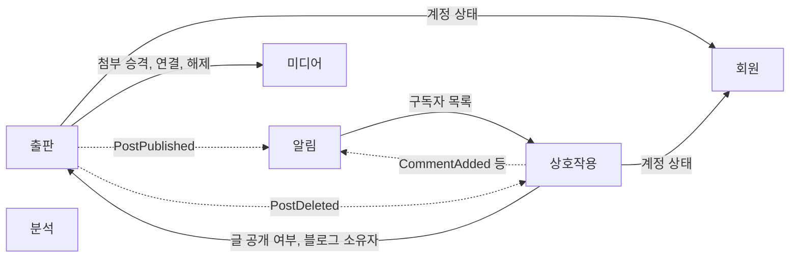

# 컨텍스트 맵

[03-bounded-contexts.md](03-bounded-contexts.md)의 컨텍스트가 서로 무엇을 주고받는지 기록한다.

## 원칙

1. **컨텍스트 사이의 호출은 자기 규칙을 지키는 데 필요한 것만 한다.**
   화면에 보여주기 위해 필요한 다른 컨텍스트의 정보는 진입점에서 조합한다(아래 "조회 조합").
   예: 출판은 글을 쓰려는 회원이 활성 상태인지 알아야 하므로 회원을 호출한다. 하지만 작성자의 표시 이름은 출판의 규칙에 쓰이지 않으므로 출판이 가져오지 않는다.
2. 의존은 한 방향이다. 두 컨텍스트가 서로를 호출하지 않는다.
3. 즉시 일관될 필요가 없는 후속 처리는 도메인 이벤트로 넘긴다.
4. 하류는 상류의 모델을 자기 언어로 번역해서 쓴다. 상류의 타입이 하류의 도메인에 나타나지 않는다.

## 관계 유형

| 유형 | 이 문서에서의 뜻 |
|---|---|
| 공개 호스트 서비스 | 상류가 여러 하류를 위해 정해 둔 공개 기능. 상류의 내부 모델은 노출하지 않는다 |
| 부패 방지 계층 | 하류가 상류의 모델을 자기 언어로 번역하는 층 |
| 고객-공급자 | 하류(고객)의 필요에 맞춰 상류(공급자)가 기능을 제공한다. 상류가 하류의 요구를 일정에 반영한다 |
| 공표된 언어 | 발행 측이 정한 이벤트 형식. 소비 측이 그대로 받는다 |
| 공유 커널 | 여러 컨텍스트가 함께 쓰는 작은 공통 기반. 도메인 개념을 넣지 않는다 |

## 관계

실선은 호출 방향(하류에서 상류로)이고, 점선은 이벤트 흐름(발행에서 소비로)이다.
분석은 다른 컨텍스트에 의존하지 않는다.

| 상류 | 하류 | 관계 | 하류가 얻는 것 | 방식 |
|---|---|---|---|---|
| 회원 | 출판 | 공개 호스트 서비스, 하류의 부패 방지 계층 | 블로거가 글을 쓸 수 있는 상태인지 | 동기 조회 |
| 회원 | 상호작용 | 공개 호스트 서비스, 하류의 부패 방지 계층 | 회원이 구독, 댓글, 좋아요를 할 수 있는 상태인지 | 동기 조회 |
| 미디어 | 출판 | 고객-공급자 (출판이 고객) | 임시 업로드 승격, 파일과 글의 연결과 해제 | 동기 호출 |
| 출판 | 상호작용 | 고객-공급자 (상호작용이 고객) | 글과 블로그의 존재, 공개 여부, 블로그 소유자 | 동기 조회, PostDeleted 이벤트 |
| 상호작용 | 알림 | 공개 호스트 서비스, 공표된 언어 | 블로그의 구독자 목록, 상호작용 이벤트 | 동기 조회, 이벤트 |
| 출판 | 알림 | 공표된 언어 | 출판 이벤트 | 이벤트 |
| 공유 커널 | 전체 | 공유 커널 | 식별자 생성, 예외 기반, 영속성 기반 | 라이브러리 |

### 출판과 미디어의 방향

글을 저장할 때 출판이 본문에서 참조하는 파일 목록을 뽑아 미디어에 넘긴다.
본문 형식(마크다운)은 출판이 소유하므로 미디어는 본문을 해석하지 않는다.

글을 삭제할 때도 출판이 미디어를 호출해 연결을 해제한다. 미디어가 출판의 삭제 이벤트를 받지 않는다.
출판이 이미 미디어를 호출하므로, 미디어가 출판의 이벤트를 받으면 두 컨텍스트가 서로에게 의존하게 된다.

## 도메인 이벤트

컨텍스트 사이를 오가는 이벤트만 적는다. 회원 내부의 이벤트는 [contexts/member/02-implementation.md](../contexts/member/02-implementation.md)에 있다.

| 이벤트 | 발행 | 소비 | 소비 측이 하는 일 | 상태 |
|---|---|---|---|---|
| PostPublished | 출판 | 알림 | 해당 블로그의 구독자에게 알림 | 확정 |
| PostDeleted | 출판 | 상호작용 | 그 글의 댓글과 좋아요 정리 | 확정 |
| CommentAdded | 상호작용 | 알림 | 블로그 소유자에게 알림 | 확정 |
| PostLiked | 상호작용 | 알림 | 블로그 소유자에게 알림 | 미정 |
| BlogSubscribed | 상호작용 | 알림 | 블로그 소유자에게 알림 | 미정 |
| AccountSuspended | 회원 | 출판 | 정지된 블로거의 블로그와 글 노출 처리 | 미정 |

이벤트에는 식별자와, 소비 측이 판단에 필요한 최소한의 값만 담는다.
예: CommentAdded는 수신자를 정할 수 있도록 블로그 소유자 ID를 담는다. 상호작용은 댓글을 받을 때 이미 출판에서 블로그 소유자를 조회했다.

영상 변환 완료와 실패는 미디어 컨텍스트 내부의 상태 전이이므로 이 표에 없다.

## 동기 호출

이벤트로 바꿀 수 없어 동기 호출로 남기는 것이다.

| 호출 | 동기여야 하는 이유 |
|---|---|
| 출판 → 미디어: 임시 업로드 승격 | 글을 저장하기 전에 바뀐 파일 주소가 필요하다 |
| 출판 → 미디어: 파일 연결과 해제 | 방향을 출판에서 미디어로 하나만 유지한다 |
| 출판 → 회원: 계정 상태 | 정지된 계정은 글을 쓸 수 없다. 쓰기 전에 판단해야 한다 |
| 상호작용 → 회원: 계정 상태 | 위와 같다 |
| 상호작용 → 출판: 글 공개 여부, 블로그 소유자 | 공개되지 않은 글에는 댓글과 좋아요를 남길 수 없다. 쓰기 전에 판단해야 한다 |
| 알림 → 상호작용: 구독자 목록 | 알림을 만들 때 수신자를 정해야 한다 |

## 조회 조합

화면에 필요한 정보를 여러 컨텍스트에서 모아 합치는 일은 진입점이 한다. 컨텍스트끼리 서로의 조회 결과를 합치지 않는다.

| 화면 | 조합하는 컨텍스트 |
|---|---|
| 글 상세 | 출판(본문), 회원(작성자 프로필), 미디어(영상), 분석(조회수), 상호작용(좋아요 수, 댓글) |
| 글 목록 | 출판(글 요약), 회원(작성자 프로필), 분석(조회수), 상호작용(좋아요 수) |
| 블로그 레이아웃 | 출판(블로그, 카테고리), 회원(소유자 프로필) |
| 댓글 목록 | 상호작용(댓글), 회원(댓글 작성자 프로필) |
| 블로그 대시보드 | 분석(통계, 인기 글 ID), 출판(글 제목과 슬러그) |
| 관리자 대시보드 | 회원(회원 목록), 출판(블로그 목록), 분석(플랫폼 통계) |

목록 화면에서는 ID 묶음으로 한 번에 조회해 건마다 호출하지 않는다.

조회수 순 정렬처럼 한 컨텍스트의 저장소 안에서 정렬해야 하는 요구가 생기면,
분석이 집계 결과를 출판 쪽 읽기 전용 모델에 복제하는 방식을 검토한다. 측정 전에 도입하지 않는다.
