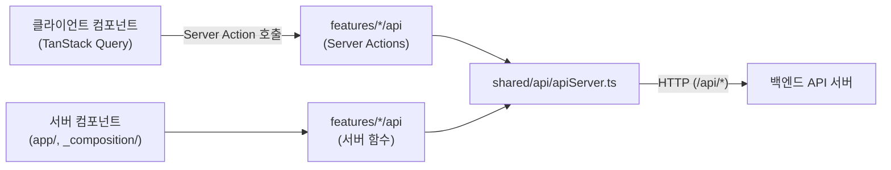

# API 통신

브라우저가 백엔드 REST API를 직접 호출하지 않고, 모든 데이터 조회와 변경이 Next.js 서버를 경유하도록 구성합니다.

## 호출 구조

| 실행 주체           | 호출 경로                                       | 설명                                                                              |
| ------------------- | ----------------------------------------------- | --------------------------------------------------------------------------------- |
| 서버 컴포넌트       | `features/*/api` → `apiServer`                  | 렌더링 중 서버 내부 네트워크(`INTERNAL_API_BASE_URL`)로 백엔드를 직접 호출합니다. |
| 클라이언트 컴포넌트 | TanStack Query 훅 → Server Action → `apiServer` | 조회(`useQuery`)와 변경(`useMutation`) 모두 Server Action을 통해 실행합니다.      |

`shared/api/apiServer.ts`는 모든 백엔드 호출에 대해 다음 공통 작업을 수행합니다.

- `INTERNAL_API_BASE_URL` 뒤에 요청 경로(`/api/...`)를 붙여 호출합니다.
- `requireAuth`(기본값 `true`)가 켜져 있으면 요청 쿠키에서 `accessToken`을 읽어 `Authorization: Bearer <토큰>` 헤더를 설정합니다.
- 백엔드가 `401`을 반환하면 `shouldRedirectOn401`(기본값 `true`)에 따라 `/login?alert=session_expired`로 리다이렉트합니다.

단, 대용량 미디어 원본 업로드와 Google OAuth 진입처럼 브라우저가 외부 엔드포인트와 직접 통신해야 하는 경우만 예외로 둡니다([04-authentication.md](04-authentication.md), [media-handling.md](../design-notes/media-handling.md) 참고).

## 오류 처리

백엔드의 모든 컨텍스트는 오류 응답을 `{ code, message }` 형식으로 반환합니다.

1. **`ApiError` 변환**: `apiServer`는 비정상 응답을 수신하면 `ApiError.from(status, body)`를 통해 상태 코드와 비즈니스 오류 코드(예: `INVALID_REQUEST`, `POST_NOT_FOUND`)를 담은 `ApiError` 인스턴스를 던집니다. 게이트웨이 오류처럼 형식이 다른 응답은 `UNKNOWN_ERROR`로 정규화합니다.
2. **Server Action 직렬화**: Next.js Server Action은 커스텀 `Error` 클래스의 필드를 브라우저로 그대로 전달하지 못하므로, 클라이언트에서 호출하는 Server Action은 예외를 잡아 직렬화 가능한 `ActionResult<T>` 유니온 타입으로 반환합니다.
   - 성공: `{ success: true, data: T }`
   - 실패: `toActionError(error)`를 통해 생성한 `{ success: false, error: SerializedError }`
3. **기능별 메시지 매핑**: 각 기능 모듈의 `errors.ts`는 백엔드 오류 코드(`error.code`)를 사용자 안내 문구로 변환합니다.

## 런타임 설정

Next.js의 `NEXT_PUBLIC_*` 환경 변수는 빌드 시점에 번들에 인라이닝되므로, 환경(dev, prod)마다 이미지를 새로 빌드해야 하는 제약이 생깁니다. 단일 컨테이너 이미지를 Kubernetes `ConfigMap` 교체만으로 모든 환경에서 실행하기 위해 모든 설정을 서버 런타임에 읽습니다.

- **서버 내부 통신 주소 (`INTERNAL_API_BASE_URL`)**: `getApiBaseUrl()`이 요청 시점에 `process.env.INTERNAL_API_BASE_URL`을 조회합니다. 클러스터 내부에서는 서비스 DNS 주소를 사용합니다.
- **브라우저 공개 설정 (`PublicConfig`)**: 루트 레이아웃(`RootLayout`)이 요청 시점에 `readPublicConfig()`로 공개 환경 변수(`PUBLIC_API_BASE_URL`, reCAPTCHA 사이트 키)를 읽어 `PublicConfigProvider`를 통해 클라이언트 컴포넌트에 전달합니다.
