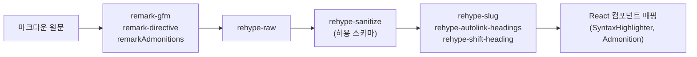

# 마크다운 처리

게시글 에디터 구성, 본문 HTML 변환과 보안 살균(Sanitization), 목차(TOC) 생성 파이프라인을 다룹니다.

## 에디터 구성

대시보드 게시글 편집기는 `@mdxeditor/editor` 기반의 클라이언트 컴포넌트(`features/publishing/components/dashboard/editor/`)로 구성됩니다.

- **클라이언트 전용 로드**: MDXEditor는 브라우저 DOM API에 의존하므로 `next/dynamic`(`ssr: false`)으로 감싼 `ForwardRefEditor`를 통해 클라이언트에서만 로드합니다.
- **지원 문법과 플러그인**: 제목, 목록, 인용구, 표(GFM), 구분선, 링크 다이얼로그, CodeMirror 기반 코드 블록 구문 강조, 콜아웃 디렉티브(`note`, `tip`, `info`, `caution`, `danger`), 원본·변경 비교(`diffSourcePlugin`) 모드를 지원하며 한국어 번역을 적용합니다.
- **기능 경계 분리**: `publishing` 모듈이 `media` 모듈을 직접 참조하지 않도록, 이미지 업로드 함수(`uploadImage`)와 영상 첨부 슬롯(`renderVideoField`)은 상위 조합 컴포넌트인 `app/dashboard/(editor)/posts/_components/PostEditor.tsx`에서 props로 주입합니다.

## 본문 렌더링

공개 게시글 상세 페이지(`app/user/[blogSlug]/posts/[postSlug]/page.tsx`)는 `react-markdown`을 사용해 서버에서 마크다운 본문을 렌더링합니다.

- **콜아웃 변환**: `remark-directive`로 파싱한 컨테이너 디렉티브(`:::note` 등)를 `remarkAdmonitions` 플러그인이 `admonition admonition-<종류>` 클래스를 가진 `
` 노드로 변환하고, 렌더 단계에서 `Admonition` 컴포넌트로 치환합니다.
- **XSS 방어**: 인라인 HTML을 처리하기 위해 `rehype-raw`를 거친 직후 반드시 `rehype-sanitize`를 실행합니다. 기본 허용 스키마(`defaultSchema`)에 콜아웃용 `div` 클래스 정규식만 제한적으로 추가하여 스크립트 삽입이나 임의 속성 주입을 차단합니다.
- **제목 단계 조정**: 페이지 제목이 `<h1>`을 사용하므로 본문 내 마크다운 제목은 `rehype-shift-heading`(`shift: 1`)을 통해 한 단계씩 낮춰(`#` → `<h2>`) 문서 제목 계층이 겹치지 않도록 유지합니다.
- **스타일 일치**: `@tailwindcss/typography`(`prose`) 설정(`tailwind.config.ts`)에서 줄 간격과 목록 마커 색상을 조정해 에디터 화면과 공개 열람 화면의 가독성을 일관되게 맞춥니다.

## 목차 생성

우측 고정 영역의 목차(`TableOfContents`)에 필요한 제목 목록은 `features/publishing/markdown/headings.ts`의 `headingsOf` 함수가 추출합니다.

- `remark-parse`로 본문 AST를 순회하여 1·2단계 제목만 수집합니다.
- 본문 렌더링 시 `rehype-slug`가 제목에 부여하는 `id` 규칙과 동일하게 `github-slugger`로 슬러그를 생성하므로, 중복 제목이나 한글 제목에서도 목차 링크가 정확한 앵커 위치로 이동합니다.
