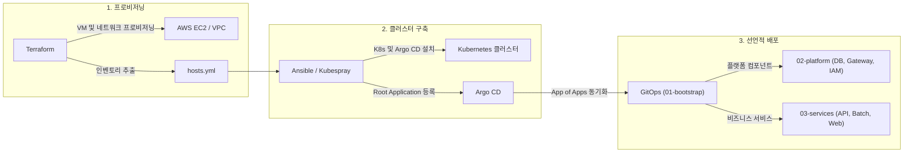

# Contentria 인프라

Contentria 서비스의 클라우드 리소스 프로비저닝, 쿠버네티스 클러스터 구축, GitOps 선언적 배포 및 시크릿 관리를 담당하는 인프라 구성 모음입니다.

## 개요

### 배포 파이프라인

Contentria 인프라는 세 단계의 도구 체인을 통해 점진적으로 구축 및 배포됩니다.



| 단계                     | 도구      | 담당 역할                                                               | 산출물 및 연계 대상                   |
| ------------------------ | --------- | ----------------------------------------------------------------------- | ------------------------------------- |
| **1. 인프라 프로비저닝** | Terraform | 클라우드 테스트 환경(VPC, 서브넷, 보안 그룹, EC2 노드) 프로비저닝       | Ansible 호스트 인벤토리 (`hosts.yml`) |
| **2. 클러스터 구축**     | Ansible   | Kubespray 기반 K8s 클러스터 설치, Argo CD 배포 및 Root App 등록         | 실행 중인 Kubernetes 및 Argo CD       |
| **3. 선언적 배포**       | Argo CD   | Git 저장소 매니페스트를 감시하여 플랫폼 인프라 및 마이크로서비스 동기화 | 동작 중인 플랫폼 및 컨테이너 서비스   |

## 디렉터리 구성

인프라 저장소는 각 도구의 책임 경계에 따라 독립된 하위 디렉터리로 분리되어 있습니다.

| 디렉터리                   | 담당 영역                                             | 상세 문서                                   |
| -------------------------- | ----------------------------------------------------- | ------------------------------------------- |
| [`terraform/`](terraform/) | 클라우드(AWS) 가상 리소스 프로비저닝                  | [Terraform 가이드](terraform/aws/README.md) |
| [`ansible/`](ansible/)     | 노드 OS 설정, Kubespray 클러스터 구축 및 Argo CD 설치 | [Ansible 가이드](ansible/README.md)         |
| [`gitops/`](gitops/)       | Argo CD 선언적 배포 매니페스트 (플랫폼 및 서비스)     | [GitOps 가이드](gitops/README.md)           |
| [`secrets/`](secrets/)     | 보안 자격 증명 템플릿 및 수동 배포 매니페스트         | [Secrets 가이드](secrets/README.md)         |

## 자동화 명령어

`infra/Makefile`에 Terraform 프로비저닝과 Ansible 클러스터 구축 명령어가 정의되어 있습니다. 모든 명령어는 `infra/` 디렉터리에서 실행하며, `make help`로 요약 목록을 조회합니다.

### 실행 변수

명령어 뒤에 `KEY=VALUE` 형식으로 전달하여 기본값을 변경합니다. (예: `make tf-plan ENV=dev`)

| 변수             | 기본값                           | 설명                                                                       |
| ---------------- | -------------------------------- | -------------------------------------------------------------------------- |
| `ENV`            | `dev`                            | 대상 Terraform Workspace 및 변수 파일(`terraform.<ENV>.tfvars`) 환경       |
| `AWS_PROFILE`    | `contentria-test`                | Terraform 실행에 사용할 로컬 AWS CLI 프로필                                |
| `SSH_DIR`        | `~/.ssh/contentria`              | Ansible 컨테이너에 마운트할 SSH 개인키(`id_ed25519`) 및 `known_hosts` 경로 |
| `RUNNER_TMP_DIR` | `~/.cache/ansible-navigator/tmp` | `ansible-navigator` 실행 시 호스트와 컨테이너가 공유할 임시 디렉터리       |

### Terraform 명령어

| 명령어              | 설명                                                               |
| ------------------- | ------------------------------------------------------------------ |
| `make tf-init`      | 프로바이더 및 백엔드 초기화                                        |
| `make tf-fmt`       | HCL 코드 포맷 검사                                                 |
| `make tf-validate`  | 구문 유효성 검사                                                   |
| `make tf-test`      | Mock 프로바이더 기반 단위 테스트 실행                              |
| `make tf-workspace` | `ENV`에 해당하는 Workspace 선택 (없으면 생성)                      |
| `make tf-plan`      | `terraform.<ENV>.tfvars` 기준 실행 계획 파일(`<ENV>.tfplan`) 생성  |
| `make tf-apply`     | 생성된 실행 계획 파일을 적용해 AWS 리소스 배포                     |
| `make tf-inventory` | Terraform 출력에서 `ansible/inventories/cloud-test/hosts.yml` 생성 |
| `make tf-destroy`   | 지정된 `ENV` 환경의 AWS 리소스 삭제                                |

### Ansible 명령어

| 명령어                 | 설명                                                                        |
| ---------------------- | --------------------------------------------------------------------------- |
| `make ansible-ee`      | Execution Environment 컨테이너 이미지(`contentria-ansible:ks2.31.0-1`) 빌드 |
| `make ansible-verify`  | 서버 접속 없이 인벤토리, 플레이북 구문, 시크릿 목록 정적 검증               |
| `make ansible-prepare` | 1단계: 노드 OS 기본 패키지, 커널 모듈, 시간대, 방화벽 설정                  |
| `make ansible-cluster` | 2단계: Kubespray 기반 Kubernetes 클러스터 구축 및 단일 노드 taint 제거      |
| `make ansible-argocd`  | 3단계: Helm 기반 Argo CD 설치 및 저장소 설정                                |
| `make ansible-gitops`  | 4단계: 필수 시크릿 확인 후 GitOps Root Application 등록                     |
| `make ansible-all`     | 1~4단계 순차 실행 (사전 시크릿 및 스토리지 준비 완료 시 사용)               |

### 실행 순서

클라우드 테스트 환경을 처음부터 구축할 때의 표준 실행 순서입니다.

```bash
cd infra

# 1. AWS 인프라 프로비저닝 및 인벤토리 추출
make tf-init
make tf-plan ENV=dev
make tf-apply ENV=dev
make tf-inventory

# 2. 실행 환경 이미지 빌드 및 정적 검증
make ansible-ee
make ansible-verify

# 3. Kubernetes 클러스터 및 Argo CD 설치
make ansible-prepare
make ansible-cluster
make ansible-argocd

# 4. 필수 시크릿 및 StorageClass 수동 준비 후 GitOps 부트스트랩
make ansible-gitops
```
