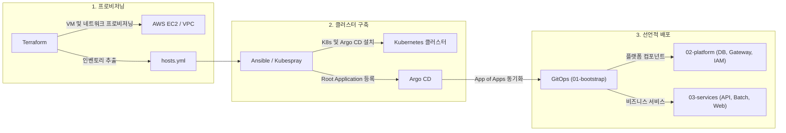

# Contentria 인프라 아키텍처

Contentria 서비스의 클라우드 리소스 프로비저닝, 쿠버네티스 클러스터 구축, GitOps 선언적 배포 및 시크릿 관리를 담당하는 인프라 구성 모음입니다.

## 아키텍처 개요

### 배포 파이프라인

Contentria 인프라는 세 단계의 도구 체인을 통해 점진적으로 구축 및 배포됩니다.



| 단계 | 도구 | 담당 역할 | 산출물 및 연계 대상 |
|---|---|---|---|
| **1. 인프라 프로비저닝** | Terraform | 클라우드 테스트 환경(VPC, 서브넷, 보안 그룹, EC2 노드) 프로비저닝 | Ansible 호스트 인벤토리 (`hosts.yml`) |
| **2. 클러스터 구축** | Ansible | Kubespray 기반 K8s 클러스터 설치, Argo CD 배포 및 Root App 등록 | 실행 중인 Kubernetes 및 Argo CD |
| **3. 선언적 배포** | Argo CD | Git 저장소 매니페스트를 감시하여 플랫폼 인프라 및 마이크로서비스 동기화 | 동작 중인 플랫폼 및 컨테이너 서비스 |

## 디렉터리 구성

인프라 저장소는 각 도구의 책임 경계에 따라 독립된 하위 디렉터리로 분리되어 있습니다.

| 디렉터리 | 담당 영역 | 상세 문서 |
|---|---|---|
| [`terraform/`](terraform/) | 클라우드(AWS) 가상 리소스 프로비저닝 | [Terraform 가이드](terraform/README.md) |
| [`ansible/`](ansible/) | 노드 OS 설정, Kubespray 클러스터 구축 및 Argo CD 설치 | [Ansible 가이드](ansible/README.md) |
| [`gitops/`](gitops/) | Argo CD 선언적 배포 매니페스트 (플랫폼 및 서비스) | [GitOps 가이드](gitops/README.md) |
| [`secrets/`](secrets/) | 보안 자격 증명 템플릿 및 수동 배포 매니페스트 | [Secrets 가이드](secrets/README.md) |

## 인프라 자동화 도구

`infra/` 디렉터리에는 전체 인프라 라이프사이클 명령을 단순화하는 `Makefile`이 마련되어 있습니다.

```bash
# 사용 가능한 명령어 확인
make help

# 1. Terraform AWS 인프라 배포 (기본: ENV=dev)
make tf-plan ENV=dev
make tf-apply ENV=dev

# 2. Terraform 결과에서 Ansible 인벤토리 파일 자동 추출
make tf-inventory

# 3. Ansible 클러스터 구축 파이프라인 일괄 실행 (1~4단계)
make ansible-all
```
