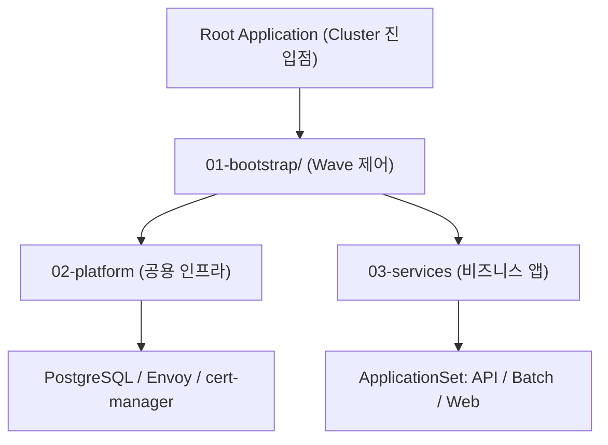

# GitOps

Kubernetes 클러스터에 배포되는 플랫폼 인프라와 비즈니스 서비스의 선언적 배포 명세 모음입니다.
Argo CD가 본 저장소를 지속적으로 감시하며 클러스터의 실제 상태를 선언된 매니페스트 상태와 동일하게 유지합니다.

## 아키텍처 개요

### App of Apps 패턴

GitOps 저장소는 하나의 Root Application이 하위 Application들을 계층적으로 관리하는 **App of Apps** 패턴을 따릅니다.

Root Application이 환경별 부트스트랩 디렉터리(`01-bootstrap/<env>/`)를 감시하면, 그 안에 정의된 개별 Application 매니페스트들이 플랫폼 컴포넌트와 비즈니스 서비스를 클러스터에 프로비저닝합니다.

### 저장소 디렉터리 구성

책임 경계에 따라 3개의 계층으로 구분됩니다.

| 디렉터리 | 담당 역할 | 포함 리소스 |
|---|---|---|
| `01-bootstrap/` | 환경별 부트스트랩 엔트리포인트 및 배포 순서 정의 | Root App이 감시할 Application 및 ApplicationSet 정의 |
| `02-platform/` | 클러스터 전역에서 공유하는 인프라 미들웨어 | Envoy Gateway, PostgreSQL (CloudNativePG), cert-manager, Keycloak, OpenFGA |
| `03-services/` | Contentria 비즈니스 마이크로서비스 | `contentria-backend-api`, `contentria-backend-batch`, `contentria-frontend-web` |

## 배포 파이프라인

### 단계별 동기화 순서

`01-bootstrap/<env>/`의 각 Application에 `argocd.argoproj.io/sync-wave` 어노테이션을 부여하여 컴포넌트 간 기동 순서를 강제합니다.
선행 wave의 모든 리소스가 `Healthy` 상태에 도달해야만 다음 wave의 동기화가 시작됩니다.

| Wave | Application | 주요 배포 리소스 | 선행 의존 조건 |
|---|---|---|---|
| **1** | `envoy-gateway` `postgres-operator` | Gateway API CRD, Envoy 컨트롤러 CloudNativePG Operator 및 CRD | 클러스터 기본 환경 |
| **2** | `cert-manager` `postgres-cluster` | cert-manager 컨트롤러, ClusterIssuer PostgreSQL 인스턴스 및 데이터베이스 | Wave 1의 Gateway API CRD Wave 1의 CloudNativePG Operator |
| **3** | `keycloak` `openfga` | IAM 인증 서비스 세부 권한 관리 엔진 | Wave 2의 PostgreSQL DB 준비 완료 |
| **4** | `services` | 백엔드 API, 배치 작업, 프론트엔드 (ApplicationSet) | Wave 1~3의 플랫폼 인프라 전체 |

- 파일명의 숫자 접두사는 `sync-wave` 값과 일치시킵니다. (예: `01-envoy-gateway.yaml` → wave `1`)
- 동일한 wave 번호를 가진 Application들은 병렬로 동시에 배포됩니다.

### 서비스 간 의존성 정책

`03-services/`에 속한 개별 마이크로서비스 간에는 인위적인 배포 wave 순서를 지정하지 않습니다.
프론트엔드와 백엔드 간의 통신은 런타임 의존성이므로, 배포 타이밍을 조절하는 대신 API의 하위 호환성을 보장하는 방식으로 해결합니다.

## 컴포넌트 패키징 규약

### 플랫폼 인프라

플랫폼 컴포넌트는 외부 Helm 차트와 사후 생성 커스텀 리소스로 나누어 관리합니다.

| 구분 | 관리 리소스 | 패키징 방식 | 관리 파일 |
|---|---|---|---|
| 컨트롤러 설치 | 외부 공급자의 컨트롤러, CRD, Webhook | Helm | `values.yaml`, `values-<env>.yaml` |
| 커스텀 리소스 | Gateway, ClusterIssuer, DB 인스턴스 | Kustomize | `base/`, `overlays/<env>/` |

- **단일 Application 통합 배포 (`cert-manager`, `envoy-gateway`)**: Helm 차트와 Kustomize 매니페스트를 하나의 Application 내 Multi-Source로 묶어 배포합니다. Kustomize 리소스에 내부 sync-wave `1`을 주어 차트 설치 직후 커스텀 리소스가 배포되도록 합니다.
- **Application 분리 배포 (`postgres`)**: Operator 설치와 Cluster 인스턴스 생성을 별도 Application으로 분리합니다. DB 클러스터 생성에는 수 분이 소요되므로 Wave 레벨에서 명확히 상태를 확인한 뒤 다음 단계로 넘어갑니다.

### 비즈니스 애플리케이션

모든 비즈니스 서비스는 Kustomize로 패키징하며, `01-bootstrap/<env>/04-services.yaml`의 **ApplicationSet**이 `03-services/*/overlays/<env>` 경로를 자동으로 탐색하여 독립된 Application으로 등록합니다.

- 디렉터리 이름(`contentria-*`)이 Argo CD 상의 애플리케이션 이름으로 자동 매핑됩니다.
- 신규 서비스를 추가할 때는 `03-services/<서비스명>/`에 `base/`와 `overlays/<env>/`를 생성하기만 하면 추가 설정 없이 자동 등록됩니다.

## 환경 격리 전략

### 베이스 및 오버레이 분리

동일한 애플리케이션 설정을 환경별로 안전하게 분리하기 위해 Kustomize 오버레이 방식을 사용합니다.

| 영역 | 환경 공통 (`base/`) | 환경별 오버레이 (`overlays/<env>/`) |
|---|---|---|
| 매니페스트 | Deployment, Service, ConfigMap 기본값 | 이미지 태그, Replicas 수, Ingress 도메인 패치 |
| Helm 차트 | 기본 파라미터 (`values.yaml`) | 환경별 오버라이드 (`values-<env>.yaml`) |
| Application | - | 환경 전용 부트스트랩 매니페스트 (`01-bootstrap/<env>/`) |

### 신규 환경 프로비저닝 절차

`prod` 등 새로운 환경을 추가하는 절차는 다음과 같습니다.

1. `01-bootstrap/dev/`를 복사하여 `01-bootstrap/prod/`를 생성하고, 내부 매니페스트의 경로를 `prod`로 변경합니다.
2. 각 플랫폼 컴포넌트에 `values-prod.yaml`을 추가합니다.
3. 모든 서비스 디렉터리에 `overlays/prod/`를 추가하여 대상 환경의 이미지 태그 및 도메인을 정의합니다.
4. 신규 클러스터의 Root Application이 해당 환경 디렉터리(`01-bootstrap/prod/`)를 감시하도록 지정합니다.

## 민감정보 관리 정책

### 시크릿 배제 원칙

데이터베이스 암호, API 토큰, 개인키 등의 보안 정보는 GitOps 저장소에 커밋하지 않습니다.

- **저장소 분리**: 시크릿 템플릿은 `infra/secrets/example/`에만 보관하며, 실제 시크릿 값은 Git 추적에서 제외된 환경별 디렉터리에서 수동 관리합니다.
- **클러스터 사전 주입**: 시크릿은 Argo CD가 서비스를 동기화하기 전에 `kubectl apply -f infra/secrets/<env>/` 명령어로 클러스터에 미리 주입되어 있어야 합니다.
- **네임스페이스 선언**: 서비스 네임스페이스가 생성되기 전 시크릿이 주입될 수 있도록 각 시크릿 매니페스트 상단에 `Namespace` 리소스를 함께 명시합니다.

### 사전 누락 방지

필수 시크릿이 누락된 상태에서 애플리케이션이 배포되면 Pod CrashLoopBackOff 장애가 발생하므로, 클러스터 초기화 단계에서 대상 환경에 필요한 시크릿 목록이 실제로 존재하는지 사전에 검증해야 합니다.

## 동기화 안정성 가이드

### 상태 판별 커스텀 정의

Argo CD 1.8 이상에서는 Application CR에 대한 기본 Health Check가 비활성화되어 있습니다.
`argocd-cm` ConfigMap에 `resource.customizations.health.argoproj.io_Application` 설정을 등록해야 하위 Application의 상태가 올바르게 전파되어 Sync Wave가 정상 동작합니다.

### 대규모 CRD 동기화

Envoy Gateway, cert-manager, CloudNativePG 등 대형 CRD는 Kubernetes Client-Side Apply의 어노테이션 용량 제한(`256KB`)을 초과할 수 있습니다. 해당 Application의 동기화 옵션에 `ServerSideApply=true`를 활성화하여 동기화 오류를 방지합니다.

### CRD 참조 지연 대응

차트가 설치하는 CRD(`ClusterIssuer`, `Gateway`)를 동일 배포 단위의 커스텀 리소스가 참조할 때, 최초 배포 시 CRD 미등록 에러가 발생할 수 있습니다.
커스텀 리소스에 `SkipDryRunOnMissingResource=true` 어노테이션과 내부 sync-wave `1`을 지정하고, Application에 재시도 정책(`syncPolicy.retry`)을 명시하여 해결합니다.
