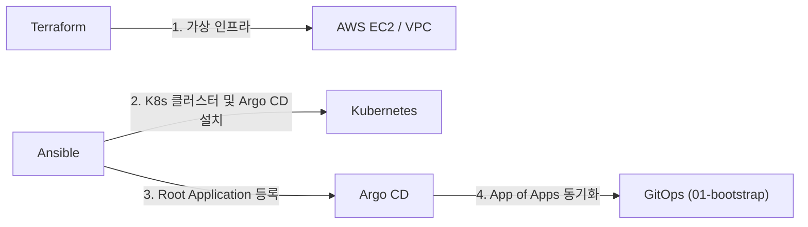

# GitOps

Argo CD가 감시하고 동기화하는 Kubernetes 배포 매니페스트 모음입니다.
인프라 프로비저닝(Terraform)과 클러스터 및 Argo CD 설치(Ansible)가 완료된 후, 클러스터에 배포되는 모든 플랫폼 컴포넌트와 비즈니스 서비스는 이 디렉터리의 선언적 매니페스트를 기준으로 자동 동기화됩니다.

## 아키텍처 개요

### 배포 파이프라인



| 단계 | 도구                | 담당 역할                                                                   |
| ---- | ------------------- | --------------------------------------------------------------------------- |
| 1    | Terraform           | 클라우드 테스트 환경(VPC, 서브넷, EC2 노드) 프로비저닝                      |
| 2    | Ansible (Kubespray) | Kubernetes 클러스터 구축 및 호스트 환경 설정                                |
| 3    | Ansible             | Argo CD 설치, 클러스터 시크릿 사전 검증, Root Application 생성              |
| 4    | Argo CD             | Root App을 통해 `01-bootstrap/<env>/`를 감시하고 플랫폼 및 서비스 자동 배포 |

### 디렉터리 구성

App of Apps 패턴을 기반으로 3계층 구조로 관리합니다.

```
gitops/
├── 01-bootstrap/           # 환경별 Root Application 및 동기화 순서 정의
│   └── dev/                # dev 클러스터의 Root App이 감시하는 엔트리포인트
├── 02-platform/            # 클러스터 공용 인프라 컴포넌트 (Helm & Kustomize)
│   ├── cert-manager/       # Let's Encrypt TLS 인증서 발급자
│   ├── envoy-gateway/      # Gateway API 구현체 (외부 트래픽 인그레스)
│   ├── postgres/           # CloudNativePG Operator 및 데이터베이스 클러스터
│   ├── keycloak/           # 인증 및 인가 서비스
│   └── openfga/            # 세부 권한 관리 엔진
└── 03-services/            # 애플리케이션 서비스 (ApplicationSet으로 자동 생성)
    ├── blog-backend-api/   # 백엔드 API 서비스
    ├── blog-backend-batch/ # 배치 작업 (CronJob)
    └── blog-frontend-web/  # 프론트엔드 웹 서비스
```

## 동기화 순서 제어

### 단계별 의존 관계

`01-bootstrap/<env>/`의 각 Application 매니페스트에 `argocd.argoproj.io/sync-wave`를 지정하여 배포 순서를 제어합니다.
Argo CD는 선행 wave의 리소스가 `Healthy` 상태에 도달한 후에만 다음 wave 배포를 진행합니다.

| Wave  | Application                            | 주요 배포 리소스                                                           | 선행 의존 대상                                              |
| ----- | -------------------------------------- | -------------------------------------------------------------------------- | ----------------------------------------------------------- |
| **1** | `envoy-gateway`<br>`postgres-operator` | Gateway API CRD, Envoy 컨트롤러<br>CloudNativePG Operator 및 CRD           | 없음                                                        |
| **2** | `cert-manager`<br>`postgres-cluster`   | cert-manager 컨트롤러, ClusterIssuer<br>PostgreSQL 클러스터 인스턴스 및 DB | Wave 1 (Gateway API CRD)<br>Wave 1 (CloudNativePG Operator) |
| **3** | `keycloak`<br>`openfga`                | IAM 인증 서비스<br>FGA 권한 엔진                                           | Wave 2 (PostgreSQL 클러스터)                                |
| **4** | `services`                             | 백엔드 API, 배치 작업, 프론트엔드 (ApplicationSet)                         | Wave 1~3 (플랫폼 전체)                                      |

> [!NOTE]
> `03-services/` 내부의 개별 마이크로서비스 간에는 인위적인 Sync Wave를 두지 않습니다. 서비스 간 호출은 런타임 의존성이므로 API 하위 호환성을 통해 흡수합니다.

### Wave 명명 규칙

- 매니페스트 파일명의 숫자 접두사는 `sync-wave` 값과 일치시킵니다. (예: `01-envoy-gateway.yaml` → wave `1`)
- 동일한 번호가 부여된 Application들은 병렬로 동시에 배포됩니다.
- 배포 순서를 조정할 때는 파일명 접두사와 내부 어노테이션 수치를 함께 수정합니다.

## 컴포넌트 패키징 구조

### 플랫폼 컴포넌트

플랫폼 컴포넌트는 Helm 차트 설치 영역과 사후 커스텀 리소스 영역으로 구분하여 관리합니다.

| 구분                   | 관리 대상                           | 패키징 도구 | 관리 경로                          |
| ---------------------- | ----------------------------------- | ----------- | ---------------------------------- |
| **외부 컨트롤러 설치** | 외부 공식 차트, CRD, Webhook        | Helm        | `values.yaml`, `values-<env>.yaml` |
| **커스텀 리소스 정의** | Gateway, ClusterIssuer, DB 인스턴스 | Kustomize   | `base/`, `overlays/<env>/`         |

- **Multi-Source 배포 (`cert-manager`, `envoy-gateway`)**: Helm 차트와 Kustomize 리소스를 단일 Application의 다중 소스로 구성합니다. Kustomize 리소스에 내부 sync-wave `1`을 부여하여 차트 설치 완료 후 커스텀 리소스가 안전하게 생성되도록 합니다.
- **Application 분리 배포 (`postgres`)**: Operator 설치와 Cluster 인스턴스 배포를 별도 Application으로 분리합니다. DB 클러스터 프로비저닝은 수 분이 소요되므로 Wave 단위의 상태 확인이 필수적입니다.

### 서비스 컴포넌트

모든 자체 개발 서비스는 Kustomize 기반으로 관리하며, `01-bootstrap/<env>/04-services.yaml`의 **ApplicationSet**이 `03-services/*/overlays/<env>` 경로를 자동으로 감지하여 개별 Application을 프로비저닝합니다.

## 환경 격리 전략

### 환경별 리소스 오버레이

환경별로 독립된 Kubernetes 클러스터와 Argo CD를 운영합니다. Root Application은 인벤토리 변수(`gitops_env`)에 따라 대상 환경 디렉터리(`01-bootstrap/{{ gitops_env }}`)만 감시합니다.

| 관리 영역            | 환경 공통 (`base`)            | 환경별 오버레이 (`overlays`)                            |
| -------------------- | ----------------------------- | ------------------------------------------------------- |
| Application 정의     | 없음 (환경별 독립 정의)       | `01-bootstrap/<env>/`                                   |
| Helm Values          | `values.yaml` (기본값)        | `values-<env>.yaml` (환경별 덮어쓰기)                   |
| Kustomize 매니페스트 | `base/` (Deployment, Service) | `overlays/<env>/` (이미지 태그, Replicas, Ingress Host) |
| 시크릿               | 없음 (Git 미추적)             | `infra/secrets/<env>/` (수동 적용)                      |

### 신규 환경 추가 절차

`prod` 등 신규 환경을 구축할 때는 다음 순서로 디렉터리와 설정을 확장합니다.

1. `01-bootstrap/dev/`를 복사하여 `01-bootstrap/prod/`를 생성하고, 내부 매니페스트 경로의 `dev`를 `prod`로 수정합니다.
2. 플랫폼 컴포넌트 디렉터리에 `values-prod.yaml`을 추가합니다.
3. Kustomize 매니페스트가 존재하는 모든 경로에 `overlays/prod/`를 추가합니다.
4. `infra/secrets/prod/`에 대상 환경 전용 시크릿을 작성합니다.
5. Ansible 인벤토리에 `gitops_env: prod`와 필수 시크릿 목록(`required_secrets`)을 등록합니다.

## 민감정보 관리

### 시크릿 분리 원칙

시크릿은 GitOps 동기화 대상에서 완전히 배제하며, Git 저장소에 커밋하지 않습니다.

```
infra/secrets/
├── README.md            # 시크릿 정의 및 수동 적용 가이드 (Git 추적)
├── example/             # 시크릿 키 템플릿 (Git 추적)
│   └── blog-backend-api.yaml
└── dev/                 # 실제 보안 변수 파일 (Git 미추적)
    └── blog-backend-api.yaml
```

- **사전 수동 배포**: 시크릿 파일은 `kubectl apply -f infra/secrets/<env>/` 명령어로 클러스터에 직접 선반영합니다.
- **네임스페이스 포함**: Argo CD가 네임스페이스를 생성하기 전에 시크릿이 먼저 주입되어야 하므로, 각 시크릿 매니페스트 상단에 `Namespace` 리소스를 함께 선언합니다.

### 사전 누락 검증

Ansible의 `40-gitops.yml` 플레이북은 Root Application을 적용하기 전, 인벤토리에 명시된 `required_secrets` 목록이 실제 클러스터에 생성되어 있는지 사전에 조회합니다. 필수 시크릿이 하나라도 누락되면 즉시 배포를 중단하여 장애를 방지합니다.

## 운영 시 주의사항

- **Application Health Check 커스텀 정의**: Argo CD 기본 설정에서는 하위 Application 리소스의 health check가 비활성화되어 있습니다. `argocd-cm` ConfigMap에 `resource.customizations.health.argoproj.io_Application` 설정을 주입해야 Sync Wave가 정상적으로 단계별 대기를 수행합니다.
- **Server-Side Apply 활성화**: `envoy-gateway`, `cert-manager`, `postgres-operator` 등 대규모 CRD는 Kubernetes Client-Side Apply의 어노테이션 크기 한계(`256KB`)를 초과할 수 있으므로 Application 동기화 옵션에 `ServerSideApply=true`를 활성화해야 합니다.
- **CRD 생성 지연 대응**: 동일 Application 내에서 차트가 설치하는 CRD를 커스텀 리소스가 참조하는 경우(`ClusterIssuer`, `Gateway`), 최초 배포 시 CRD 미등록 에러가 발생하지 않도록 `SkipDryRunOnMissingResource=true`와 적절한 재시도 정책(`syncPolicy.retry`)을 부여합니다.
- **Root Application 관리 위치**: Root Application 정의 매니페스트는 `01-bootstrap/` 내부에 두지 않고 Ansible Role 템플릿에서 직접 생성합니다. 이를 통해 Root App이 자기 자신을 재귀적으로 감시하고 덮어쓰는 순환 참조 문제를 방지합니다.
