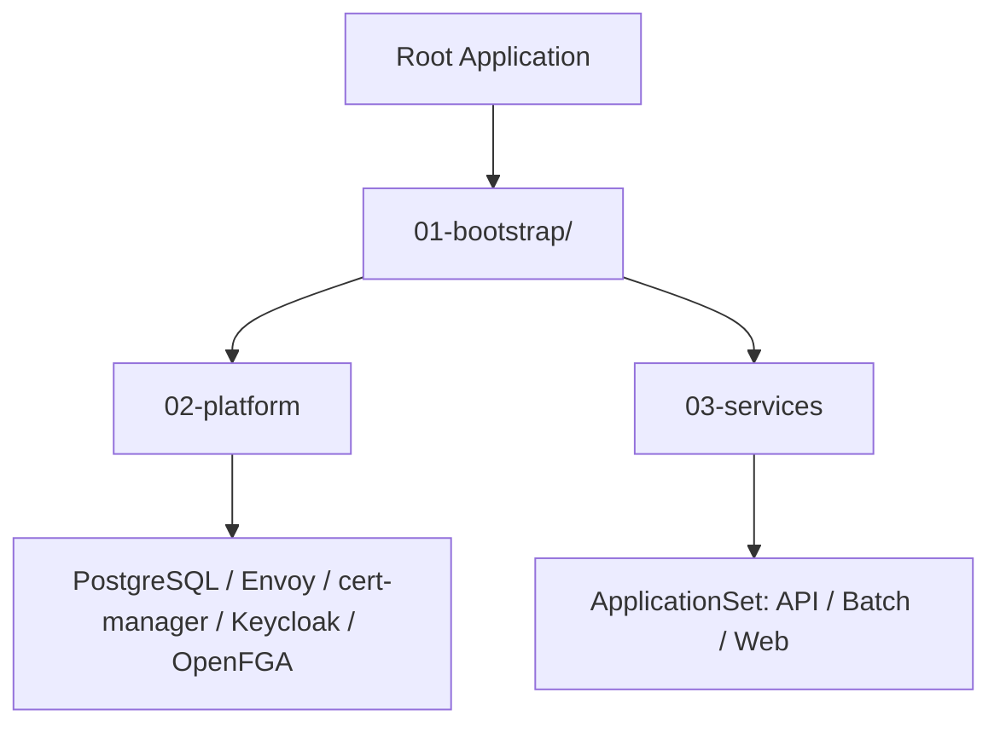

# GitOps

Kubernetes 클러스터에 배포되는 플랫폼 인프라와 비즈니스 서비스의 선언적 매니페스트 모음입니다. Argo CD가 본 저장소를 감시하며 클러스터 상태를 선언된 명세와 동기화합니다.

## 개요

### 관리 구조

하나의 Root Application이 하위 Application들을 계층적으로 관리하는 App of Apps 구조를 따릅니다. Root Application이 환경별 진입점(`01-bootstrap/<env>/`)을 감시하면, 하위 Application들이 플랫폼 컴포넌트와 비즈니스 서비스를 클러스터에 배포합니다.

데이터베이스 암호와 API 키 등 민감정보는 GitOps 저장소에 포함하지 않으며, 동기화 전에 [Secrets 가이드](../secrets/README.md)에 따라 클러스터에 별도 주입합니다.

### 디렉터리 구성

| 디렉터리        | 담당 역할                                  | 포함 리소스                                                                     |
| --------------- | ------------------------------------------ | ------------------------------------------------------------------------------- |
| `01-bootstrap/` | 환경별 부트스트랩 진입점 및 배포 순서 정의 | Root App이 감시하는 Application, ApplicationSet                                 |
| `02-platform/`  | 클러스터 공용 인프라 미들웨어              | Envoy Gateway, PostgreSQL (CloudNativePG), cert-manager, Keycloak, OpenFGA      |
| `03-services/`  | Contentria 비즈니스 서비스                 | `contentria-backend-api`, `contentria-backend-batch`, `contentria-frontend-web` |

## 패키징 구성

### 플랫폼 컴포넌트

플랫폼 미들웨어는 외부 공급자의 Helm 차트와 자체 커스텀 리소스를 구분하여 구성합니다.

| 구분          | 관리 리소스                         | 패키징 방식 | 관리 파일                          |
| ------------- | ----------------------------------- | ----------- | ---------------------------------- |
| 컨트롤러 설치 | 외부 컨트롤러, CRD, Webhook         | Helm        | `values.yaml`, `values-<env>.yaml` |
| 커스텀 리소스 | Gateway, ClusterIssuer, DB 클러스터 | Kustomize   | `base/`, `overlays/<env>/`         |

- **통합 배포 (`cert-manager`, `envoy-gateway`)**: 하나의 Application 안에서 Multi-Source로 Helm 차트와 Kustomize 매니페스트를 함께 배포합니다.
- **분리 배포 (`postgres`)**: DB 인스턴스 기동 대기 시간을 명확히 검증하기 위해 Operator 설치와 Cluster 생성을 별도 Application으로 분리합니다.

### 비즈니스 서비스

모든 비즈니스 서비스는 Kustomize로 구성합니다. `01-bootstrap/<env>/04-services.yaml`의 ApplicationSet이 `03-services/*/overlays/<env>` 경로를 탐색하여 디렉터리 이름(`contentria-*`) 그대로 개별 Application을 자동 등록합니다. 신규 서비스는 `03-services/<서비스명>/` 하위에 `base/`와 `overlays/<env>/`만 추가하면 별도 부트스트랩 수정 없이 반영됩니다.

## 동기화 제어

### 배포 순서

`01-bootstrap/<env>/`의 매니페스트에 `argocd.argoproj.io/sync-wave` 어노테이션을 지정해 기동 순서를 제어합니다. 파일명 숫자 접두사는 wave 번호와 일치시키며, 선행 wave의 모든 Application이 `Healthy` 상태에 도달한 뒤 다음 wave가 실행됩니다.

| Wave  | Application                            | 주요 리소스                                               | 선행 조건                     |
| ----- | -------------------------------------- | --------------------------------------------------------- | ----------------------------- |
| **1** | `envoy-gateway` `postgres-operator` | Gateway API CRD, Envoy 컨트롤러 CloudNativePG Operator | 클러스터 기본 환경            |
| **2** | `cert-manager` `postgres-cluster`   | cert-manager, ClusterIssuer PostgreSQL 인스턴스 및 DB  | Wave 1의 CRD 및 Operator 준비 |
| **3** | `keycloak` `openfga`                | IAM 인증 서버 권한 관리 엔진                           | Wave 2의 PostgreSQL DB 준비   |
| **4** | `services`                             | 백엔드 API, 배치, 프론트엔드 (ApplicationSet)             | Wave 1~3 플랫폼 미들웨어 준비 |

동일한 wave 내 Application들은 병렬 배포됩니다. `03-services/` 내 개별 서비스 간에는 배포 순서를 강제하지 않으며 API 하위 호환성으로 런타임 의존성을 처리합니다.

### 동기화 옵션

- **`ServerSideApply=true`**: Envoy Gateway, cert-manager, CloudNativePG 등 대형 CRD가 Client-Side Apply 어노테이션 크기 제한(`256KB`)을 초과하지 않도록 활성화합니다.
- **`SkipDryRunOnMissingResource=true`**: 차트가 설치하는 CRD(`Gateway`, `ClusterIssuer`)와 이를 참조하는 커스텀 리소스를 함께 배포할 때 초기 미등록 오류를 방지하기 위해 커스텀 리소스에 내부 wave `1` 및 재시도(`retry`) 정책과 함께 지정합니다.

## 환경 관리

### 오버레이 구조

환경 공통 설정과 환경별 변경 사항을 분리하여 관리합니다.

| 영역        | 공통 기본값   | 환경별 설정                                 |
| ----------- | ------------- | ------------------------------------------- |
| Kustomize   | `base/`       | `overlays/<env>/` (태그, 복제본 수, 도메인) |
| Helm        | `values.yaml` | `values-<env>.yaml`                         |
| Application | -             | `01-bootstrap/<env>/`                       |

### 환경 추가

`prod` 등 신규 환경을 추가할 때는 아래 순서를 따릅니다.

1. `01-bootstrap/dev/`를 복사해 `01-bootstrap/prod/`를 만들고 내부 참조 경로를 `prod`로 변경합니다.
2. 각 플랫폼 컴포넌트에 `values-prod.yaml`과 필요한 `overlays/prod/`를 추가합니다.
3. 각 서비스 디렉터리에 `overlays/prod/`를 추가해 이미지 태그와 도메인을 지정합니다.
4. 대상 클러스터의 Root Application 경로를 `01-bootstrap/prod`로 지정합니다.
