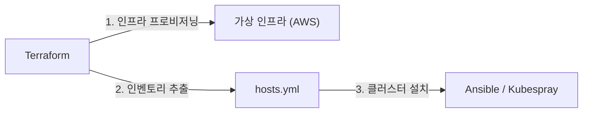

# Terraform

Contentria 인프라의 클라우드 리소스 프로비저닝을 담당하는 Terraform 구성 모음입니다.

## 개요

베어메탈 홈 서버 환경에 적용하기 전, 클라우드 환경에서 Kubernetes 클러스터 설치 및 GitOps 파이프라인을 사전 검증하기 위한 가상 인프라를 프로비저닝합니다.

- **[AWS (EC2 / VPC)](aws/README.md)**: Rocky Linux 10 기반의 Kubernetes 테스트 노드 환경 구성

## 역할 경계

Terraform은 **가상 인프라(컴퓨팅, 네트워크, 보안) 프로비저닝과 기본 접속 환경 구축**까지를 담당합니다.
프로비저닝 완료 후 생성된 노드 접속 정보를 담은 Ansible 인벤토리(`hosts.yml`)를 후속 도구로 전달합니다.



## 환경 격리 규칙

- **작업 공간(Workspace)**: 환경 간 상태 격리를 위해 Terraform Workspace(`dev` 등)를 사용합니다.
- **변수 파일**: 예시 템플릿(`terraform.example.tfvars`)을 기반으로 `terraform.<환경>.tfvars`(예: `terraform.dev.tfvars`) 파일을 생성하여 주입합니다.
- **상태 관리**: 워크스페이스별 상태는 로컬 `terraform.tfstate.d/<환경>/` 하위에 격리 저장되며, Git 추적에서 제외됩니다.

## 실행 방법

상위 `infra/` 디렉터리의 `Makefile`을 사용하거나 각 플랫폼 디렉터리에서 직접 실행합니다. 상세 실행 절차는 [AWS 프로비저닝 가이드](aws/README.md#프로비저닝-절차)를 참고합니다.

```bash
# dev 환경 인프라 배포 (기본: ENV=dev)
make -C infra tf-plan ENV=dev
make -C infra tf-apply ENV=dev

# Ansible 인벤토리 파일 생성
make -C infra tf-inventory
```
