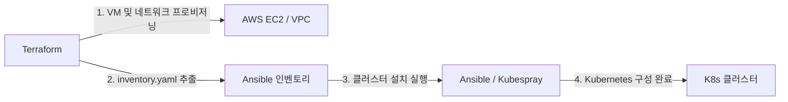

# Terraform - AWS

Terraform을 사용하여 AWS 상에 Rocky Linux 10 기반의 Kubernetes 테스트 노드 환경을 프로비저닝하는 절차를 설명합니다.

## 아키텍처 개요

### 인프라 구성

기본 토폴로지는 서울 리전(`ap-northeast-2`)의 단일 가용 영역 내 EC2 인스턴스 2대 환경입니다.

- **네트워크**: 전용 VPC(`/16`), 퍼블릭 서브넷(`/24`), 인터넷 게이트웨이 및 기본 라우팅 테이블
- **보안**: 관리자 IP 전용 인바운드 보안 그룹 (SSH: 22, Kubernetes API: 6443), EC2 Key Pair
- **컴퓨팅**: `t3.medium` 인스턴스 2대 (Standard Credit 모드)
- **스토리지**: 노드별 암호화된 gp3 루트 볼륨 40 GiB
- **IP 할당**: 노드별 공인 IPv4 및 고정 사설 IPv4

> [!NOTE]
> NAT Gateway, EIP 및 로드밸런서는 프로비저닝하지 않습니다. 외부 접근은 보안 그룹에 등록된 관리자 IP로만 제한되며, 노드 간 통신은 사설 IP 대역을 통해 이루어집니다.

### 파이프라인 워크플로

인프라 구축 파이프라인에서 Terraform의 책임 범위는 **가상 인프라(VM 및 네트워크) 프로비저닝과 인벤토리 파일 생성**까지입니다.



Terraform 배포가 완료되면 노드 IP 정보를 담은 `inventory.yaml`을 추출하여 후속 도구인 Ansible(Kubespray)로 전달합니다. 이후 OS 설정, Kubernetes 클러스터 설치, CNI 구성 및 Argo CD 배포는 Ansible이 담당합니다.

## 사전 준비

### 도구 요구사항

- Terraform 1.7 이상 (2.0 미만)
- AWS CLI v2 (`brew install awscli`)
- SSH 키 쌍 (`~/.ssh/id_ed25519.pub`)

### 계정 환경 검증

저장소 코드에는 AWS 자격 증명을 포함하지 않습니다. 로컬 프로필을 생성하고 리전 가용성을 확인합니다.

```bash
# 1. AWS CLI 로컬 프로필 구성
aws configure --profile contentria-test
export AWS_PROFILE=contentria-test

# 2. 인증 및 권한 확인
aws sts get-caller-identity

# 3. 리전 가용 영역 조회 (조직 SCP 정책 차단 여부 확인)
aws ec2 describe-availability-zones --region ap-northeast-2 --query 'AvailabilityZones[].ZoneName'

# 4. VPC 생성 권한 Dry-run 검증
aws ec2 create-vpc --region ap-northeast-2 --cidr-block 10.80.0.0/16 --dry-run
```

### 배포 파라미터 정의

공식 배포처([Rocky Linux 공식 다운로드](https://rockylinux.org/download))에서 대상 리전의 최신 공식 x86_64 AMI를 확인하고, 관리자 접근 정보를 준비합니다.

```bash
# 공식 계정(792107900819)의 Rocky 10 AMI 검색
aws ec2 describe-images --region ap-northeast-2 --owners 792107900819 \
  --filters 'Name=name,Values=Rocky-10-EC2-Base*' 'Name=architecture,Values=x86_64' \
  --query 'sort_by(Images,&CreationDate)[].{ID:ImageId,Name:Name,Created:CreationDate}' \
  --output table

# 관리자 공인 IP 확인
curl -s https://checkip.amazonaws.com
```

확인한 AMI ID, 소유자 ID, SSH 공개키 문자열, 관리자 IP 대역(`/32`)을 `terraform.tfvars`에 정의합니다.

## 프로비저닝 절차

### 인프라 배포

```bash
# 1. 변수 템플릿 복사 및 값 수정
cp terraform.tfvars.example terraform.tfvars

# 2. 공급자 초기화 및 구문 검증
terraform init
terraform fmt -check -recursive
terraform validate

# 3. 단위 테스트 및 실행 계획 수립
terraform test
terraform plan -out=cluster.tfplan

# 4. 인프라 프로비저닝 실행
terraform apply cluster.tfplan
```

### 노드 접속 확인

배포 완료 후 콘솔에 출력된 노드의 공인 IP로 SSH 접속을 검증합니다.

```bash
ssh -i ~/.ssh/id_ed25519 rocky@<출력된_공인IP>
```

### Ansible 인벤토리 생성

Terraform 출력값을 기반으로 Kubespray가 소비할 인벤토리 파일을 생성합니다.

```bash
terraform output -raw ansible_inventory > inventory.yaml
```

- **노드 매핑**: 모든 인스턴스가 `kube_control_plane`과 `kube_node` 그룹에 공통 지정됩니다.
- **etcd 토폴로지**: 짝수 etcd 구성을 방지하기 위해 1~2노드 환경에서는 첫 번째 노드만 etcd로 지정하며, 3노드 이상에서는 상위 3대를 etcd로 지정합니다.

## 환경 관리

### 상태 파일 관리

- 기본적으로 로컬 State 파일(`terraform.tfstate`)을 생성합니다.
- 팀 협업 또는 지속적 배포 환경에서는 원격 백엔드(S3 버킷 및 DynamoDB 락 테이블)로 마이그레이션하여 관리합니다.
- `terraform.tfvars`, `terraform.tfstate`, `inventory.yaml` 파일은 Git 버전 관리에서 제외합니다.

### 리소스 삭제

테스트 완료 후 과금을 방지하기 위해 프로비저닝된 모든 AWS 리소스를 삭제합니다.

```bash
terraform plan -destroy -out=destroy.tfplan
terraform apply destroy.tfplan
```
